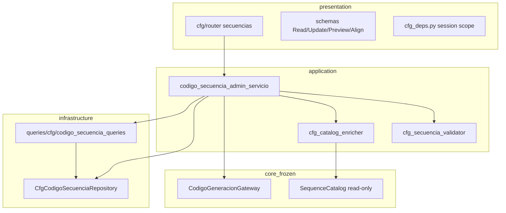

# Arquitectura del módulo administrativo CFG

---

## 1. Visión general



**Principio:** el módulo admin **orquesta**; el motor **ejecuta** preview/align/validación.

---

## 2. Componentes propuestos

### 2.1 Capa presentation (`app/modules/cfg/`)

| Artefacto | Responsabilidad |
|-----------|-----------------|
| `presentation/endpoints_codigo_secuencia.py` | Rutas REST §03 |
| `presentation/schemas.py` | SecuenciaRead, SecuenciaUpdate, PreviewRequest/Response, AlignRequest/Response, DiagnosticoRead |
| `presentation/cfg_deps.py` | `get_cfg_session_client_id`, gates TENANT |
| `presentation/router.py` | `include_router` bajo `/cfg` |

### 2.2 Capa application

| Servicio | Responsabilidad |
|----------|-----------------|
| `list_codigo_secuencias_servicio` | Paginación + filtros + enrich catálogo |
| `get_codigo_secuencia_servicio` | Detalle cross-scope 404 |
| `update_codigo_secuencia_servicio` | PATCH B-fields; org_empresa lock |
| `activar/desactivar_codigo_secuencia_servicio` | es_activo |
| `preview_codigo_secuencia_servicio` | Build GenerationContext → Gateway.preview |
| `align_codigo_secuencia_servicio` | Gateway.align_counter + audit |
| `diagnosticar_codigo_secuencia_servicio` | DGN-01..06 |
| `validar_config_codigo_secuencia_servicio` | MNT-02 dry-run |

| Helper interno | Responsabilidad |
|----------------|-----------------|
| `cfg_catalog_enricher` | Une cfg row + SequenceCatalog metadata |
| `cfg_secuencia_validator` | BR-CUST-01, org_empresa rules, immutables |
| `cfg_scope_context_builder` | GenerationContext desde fila cfg + sesión ERP |

### 2.3 Capa infrastructure

| Artefacto | Responsabilidad |
|-----------|-----------------|
| `queries/cfg/codigo_secuencia_queries.py` | Dual-path session; list con paginación ERP |
| `CfgCodigoSecuenciaRepository` | **Reutilizar** — extender solo si falta update numero_inicial |

**Prohibido:** queries que llamen `update_ultimo_numero` desde servicios admin excepto vía Gateway align path interno al motor.

---

## 3. Flujos principales

### 3.1 Actualizar configuración

```text
PATCH /cfg/secuencias/{id}
  → RBAC actualizar
  → get row (cliente_id scope)
  → cfg_secuencia_validator (inmutables, org_empresa lock, anti-colisión)
  → session.begin()
  → update_secuencia(...) o query dedicada
  → commit
  → SecuenciaRead enriquecido
```

### 3.2 Preview

```text
POST .../preview
  → RBAC consultar
  → build GenerationContext(scope desde fila + sesión)
  → CodigoGeneracionGateway.preview(key, context, session)
  → PreviewResponse (sin side effects)
```

### 3.3 Align mantenimiento

```text
POST .../align
  → RBAC mantener
  → validar candidate_code parseable
  → session.begin()
  → CodigoGeneracionGateway.align_counter(...)
  → audit log
  → commit
```

---

## 4. Ubicación en arquitectura ERP V4

| Aspecto | Decisión |
|---------|----------|
| ¿Módulo ERP o Platform? | **ERP** — datos tenant en cfg_codigo_secuencia |
| Código módulo | `cfg` |
| Conexión BD | `DatabaseConnection.DEFAULT` + `get_connection_for_tenant` |
| Clasificación entidad | TENANT (recurso cfg es del cliente) |
| Impersonación | cliente_id JWT operativo |

No replicar patrón legacy `tenant/superadmin` CRUD.

---

## 5. Riesgos y mitigaciones

| ID | Riesgo | Severidad | Mitigación |
|----|--------|-----------|------------|
| R-01 | Dedicated escribe en CP | Alta | ADJ-03 session obligatoria |
| R-02 | PATCH ultimo_numero vía bug | Alta | Validator rechaza; no método REST |
| R-03 | Drift policy cfg/catálogo | Media | DGN-01 alert |
| R-04 | Desactivar org_empresa | Alta | Lock v1 |
| R-05 | Preview malinterpretado como reserva | Media | Disclaimer API + UX |
| R-06 | Align sin evidencia | Media | Motivo obligatorio + permiso mantener |
| R-07 | Listado sin paginación | Media | Contrato v1 ERP |
| R-08 | Bypass Gateway en admin | Alta | Code review; solo GW preview/align |

---

## 6. Estrategia de implementación

Ver fases A–F en [`00_EXECUTIVE_SUMMARY.md`](00_EXECUTIVE_SUMMARY.md).

### Orden recomendado

1. **Schemas + queries read** (sin mutación)
2. **Enricher catálogo** + tests drift
3. **PATCH config** + validator org_empresa
4. **Preview** (Gateway wiring)
5. **Diagnóstico**
6. **Align** + auditoría
7. **RBAC seeds** en PermissionRegistry / bootstrap permisos
8. **Frontend** contrato estable

### Dependencias externas

| Dependencia | Estado |
|-------------|--------|
| Motor Gateway preview/align | ✅ Existe |
| SequenceCatalog | ✅ Congelado lectura |
| Ola 1 ORG | ✅ Cerrada |
| Tabla audit historial | ❌ Opcional Fase F |

### Testing (futuro)

| Tipo | Casos |
|------|-------|
| Unit | validator, enricher, org_empresa lock |
| Integration | PATCH + preview + align mocked GW |
| RBAC | 403 sin permiso |
| Dedicated | session tenant path |

---

## 7. Lo que el módulo NO es

| No es | Es en cambio |
|-------|--------------|
| Editor del SequenceCatalog | Solo lectura enrich |
| CRUD de códigos de negocio | Solo cfg contador/config |
| Admin fiscal series | Store FISCAL separado |
| Sustituto allocate ERP | Runtime sigue en módulos operativos |

---

*Documentación normativa motor: `app/docs/arquitectura/code-generation/`*
