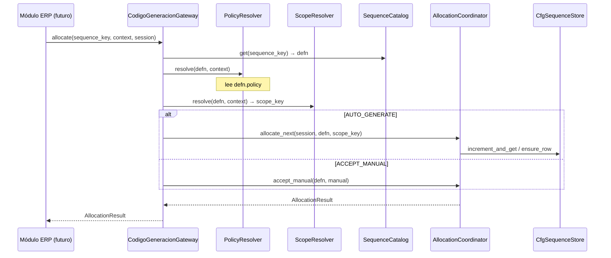
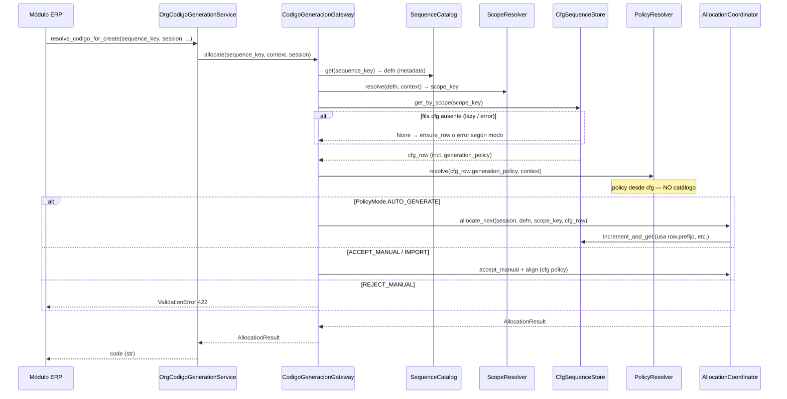

# Motor de Códigos — Flujo oficial con política en cfg

**Estado:** Diseño — sin implementación  
**Fecha:** 2026-07-11

---

## 1. Flujo AS-IS (Ola 0)



**Problema:** `PolicyResolver` decide con **`defn.policy` (catálogo estático)**, no con configuración del tenant.

---

## 2. Flujo TO-BE (normativo)



---

## 3. Reglas de decisión de política

### 3.1 PolicyResolver (sin cambio lógico, cambio input)

| `generation_policy` (cfg) | `manual_code` | `operation` | `PolicyMode` |
|---------------------------|---------------|-------------|--------------|
| AUTO_REQUIRED | vacío | CREATE | AUTO_GENERATE |
| AUTO_REQUIRED | presente | CREATE | REJECT_MANUAL |
| AUTO_REQUIRED | presente | IMPORT | IMPORT_HISTORICAL |
| AUTO_DEFAULT | vacío | CREATE | AUTO_GENERATE |
| AUTO_DEFAULT | presente | CREATE | ACCEPT_MANUAL |
| AUTO_DEFAULT | presente | IMPORT | IMPORT_HISTORICAL |
| MANUAL_ONLY | vacío | CREATE | REJECT_MANUAL * |
| MANUAL_ONLY | presente | CREATE | ACCEPT_MANUAL * |

\* `MANUAL_ONLY` requiere extensión PolicyResolver (hoy no implementada — ver §6).

### 3.2 Orden de operaciones en allocate

| Paso | Acción | TX |
|------|--------|-----|
| 1 | Validar `sequence_key` en catálogo | — |
| 2 | Resolver `scope_key` | — |
| 3 | **Cargar fila cfg** (obligatoria steady-state) | lectura |
| 4 | Validar `cfg.es_activo` | — |
| 5 | Resolver `PolicyMode` desde **`cfg.generation_policy`** | — |
| 6 | AUTO → increment contador | escritura |
| 7 | MANUAL → validate + optional align | escritura condicional |

**Regla:** pasos 6–7 en la **misma sesión** que el INSERT ERP del caller.

---

## 4. Bootstrap y lazy-create en el flujo

### 4.1 Onboarding seed (eager)

```
SequenceCatalog.default_generation_policy
  → OnboardingSequenceSeed (+ generation_policy)
  → seed_cfg_tenant / seed_cfg_empresa
  → INSERT cfg_codigo_secuencia (con generation_policy explícito)
```

### 4.2 Lazy ensure_row (ALMACEN / PUNTO_VENTA)

```
Primera allocate con scope ALMACEN/PV
  → CfgSequenceStore.ensure_row
  → INSERT cfg con defaults catálogo + generation_policy = catalog.default
```

**Prohibido:** lazy row sin `generation_policy`.

### 4.3 Empresa Bootstrap V1

```
POST /org/empresa
  → insertar_secuencias_codigo (56 filas EMPRESA)
  → cada fila incluye generation_policy sembrado
```

Sin cambio de flujo — **solo columna adicional** en INSERT.

---

## 5. Preview flow

```
preview(sequence_key, context, session)
  → defn (catálogo) — supports_preview
  → scope_key
  → cfg_row (read_for_preview — sin consumir)
  → PolicyResolver opcional: rechazar preview si MANUAL_ONLY futuro
  → format siguiente número desde cfg row
```

Preview **no consume** contador; lee `ultimo_numero` de cfg.

---

## 6. Extensión MANUAL_ONLY (diseño)

Hoy `PolicyResolver` lanza `ValueError` para políticas no AUTO_*.

**Extensión requerida antes de usar MANUAL_ONLY en cfg:**

```python
if policy == CodePolicy.MANUAL_ONLY:
    if not manual:
        return PolicyMode.REJECT_MANUAL
    return PolicyMode.ACCEPT_MANUAL  # sin auto-generate posible
```

---

## 7. Puntos de integración ERP (futuro)

| Consumidor | Flujo |
|------------|-------|
| `OrgCodigoGenerationService` | Sin cambio firma — gateway resuelve policy internamente |
| INV movimiento | allocate AUTO_REQUIRED — policy desde cfg fila `inv_movimiento` |
| Repair scripts | Backfill `generation_policy` desde catálogo |

---

## 8. Veredicto flujo

El flujo oficial steady-state es: **catálogo → metadata; cfg → policy + formato + contador; PolicyResolver → cfg.policy; AllocationCoordinator → sin cambio estructural.**
