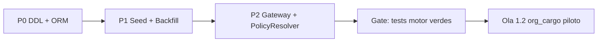

# Motor de Códigos — Estrategia de implementación (policy → cfg)

**Estado:** Diseño — sin implementación  
**Fecha:** 2026-07-11  
**Prerequisito:** Aprobación de `01_POLICY_ARCHITECTURE.md` … `04_BOOTSTRAP_IMPACT.md`

---

## 1. Principios de implementación

| # | Principio |
|---|-----------|
| P1 | **Una sola tabla de configuración** — `cfg_codigo_secuencia` |
| P2 | **Policy migration antes de Ola 1.2** — primera entidad ORG con motor |
| P3 | **Semilla explícita** — bootstrap Python envía `generation_policy` por fila |
| P4 | **Catálogo = metadata + defaults** — no autoridad runtime post-backfill |
| P5 | **Sin cambio de contrato gateway** — firmas públicas estables |
| P6 | **Repair idempotente** — tenants existentes backfill antes de runtime |

---

## 2. Fases propuestas

### Fase P0 — Esquema y modelo (bloqueante)

| Tarea | Artefacto | Notas |
|-------|-----------|-------|
| P0.1 | Script DDL `V0xx__cfg_generation_policy.sql` | ADD COLUMN + CHECK; DEFAULT temporal solo migración |
| P0.2 | `CfgCodigoSecuenciaTable` | Columna ORM |
| P0.3 | `CfgSequenceRow` dataclass | Campo `generation_policy: CodePolicy` |
| P0.4 | Queries INSERT/SELECT cfg | Incluir columna |

**Gate P0:** DDL aplicable en Shared y Dedicated sin romper inserts actuales (DEFAULT temporal).

### Fase P1 — Bootstrap y persistencia

| Tarea | Artefacto |
|-------|-----------|
| P1.1 | `SequenceDefinition.policy` → `default_generation_policy` (rename semántico) |
| P1.2 | `OnboardingSequenceSeed` + `from_definition` | Copiar default policy |
| P1.3 | `CfgCodigoSecuenciaRepository.insert_secuencia` | Param obligatorio |
| P1.4 | `cfg_codigo_onboarding_seed` | Propagar |
| P1.5 | `CfgSequenceStore.ensure_row` | Lazy INSERT con policy |
| P1.6 | Repair script `repair_cfg_generation_policy` | Backfill idempotente |
| P1.7 | Tests seed F17D / EBS V1 | Assert policy por familia |

**Gate P1:** Nuevo tenant y nueva empresa sembran policy explícita; backfill ejecutado en staging.

### Fase P2 — Runtime motor

| Tarea | Artefacto |
|-------|-----------|
| P2.1 | `PolicyResolver.resolve(generation_policy, context)` | Nueva firma |
| P2.2 | `CodigoGeneracionGateway` allocate/preview/validate_manual | Cargar cfg antes de resolve |
| P2.3 | Error explícito cfg ausente/inactiva | `ValidationError` / `NotFoundError` |
| P2.4 | Tests `test_codigo_engine_ola0` | Actualizar PolicyResolver |
| P2.5 | Tests integración gateway + cfg | Nuevo coverage |

**Gate P2:** Allocate usa cfg policy; catálogo no interviene en resolve steady-state.

### Fase P3 — Endurecimiento (opcional pre-Ola 1.2)

| Tarea | Descripción |
|-------|-------------|
| P3.1 | Soporte `MANUAL_ONLY` en PolicyResolver | Extensión enum |
| P3.2 | DROP DEFAULT SQL post-backfill | Limpieza DDL |
| P3.3 | Gobernanza drift catálogo vs cfg | Alerta/repair periódico |
| P3.4 | UI admin futura | Fuera de alcance Ola 1 |

---

## 3. Orden de ejecución recomendado

**Prohibido:** iniciar Ola 1.2 (servicio ORG cargo con motor) antes de **Gate P2**.

**Permitido en paralelo:** Ola 1.1 `OrgCodigoGenerationService` ya implementado — no bloqueado.

---

## 4. Cambios por archivo (checklist)

### 4.1 Core motor

| Archivo | Cambio |
|---------|--------|
| `app/core/codigo/sequence_definition.py` | Rename `policy` → `default_generation_policy` |
| `app/core/codigo/sequence_catalog.py` | `_def()` usa nuevo nombre; derivados documentados |
| `app/core/codigo/resolvers/policy_resolver.py` | Firma `(CodePolicy, GenerationContext)` |
| `app/core/codigo/gateway/codigo_generacion_gateway.py` | Cargar cfg; pasar policy a resolver |
| `app/core/codigo/stores/cfg_sequence_store.py` | ensure_row, from_dict |
| `app/core/codigo/onboarding_seed.py` | Seed con policy |

### 4.2 Infra / bootstrap

| Archivo | Cambio |
|---------|--------|
| `app/infrastructure/database/tables.py` | Columna cfg |
| `app/infrastructure/database/repositories/cfg_codigo_secuencia_repository.py` | INSERT |
| `app/modules/tenant/application/services/cfg_codigo_onboarding_seed.py` | Propagación |
| `app/modules/org/application/services/empresa_bootstrap_service.py` | Sin cambio API |
| `app/infrastructure/provisioning/dedicated_tenant_seed_adapters.py` | Sin cambio estructural |

### 4.3 Sin cambio

| Archivo | Razón |
|---------|-------|
| `allocation_coordinator.py` | Policy fuera de scope |
| `scope_resolver.py` | Sin policy |
| `org_codigo_generation_service.py` | Gateway opaco |
| OpenAPI ORG | Sin endpoint cfg policy en Ola 1 |

---

## 5. Estrategia de migración datos

### 5.1 Tenants existentes (Shared)

1. Aplicar DDL con DEFAULT temporal `AUTO_DEFAULT`.
2. Ejecutar `repair_cfg_generation_policy`:
   - `UPDATE cfg SET generation_policy = catalog.default WHERE …`
3. Validar: 0 NULL; F2 keys = AUTO_REQUIRED.
4. Opcional: DROP DEFAULT constraint.

### 5.2 Dedicated recién provisionados

- Seed path P1 cubre nuevos.
- Activación legacy: repair en pipeline activación si cfg pre-migración.

### 5.3 Rollback plan

| Nivel | Acción |
|-------|--------|
| Pre-P2 | Revertir código seed; columna ignorada |
| Post-P2 | **No rollback sin restore BD** — runtime depende de cfg |

---

## 6. Estrategia de tests

| Capa | Casos mínimos |
|------|---------------|
| Unit PolicyResolver | AUTO_REQUIRED, AUTO_DEFAULT, IMPORT, REJECT_MANUAL — input `CodePolicy` |
| Unit seed | Cada familia F1/F2 policy correcta |
| Unit gateway | Mock cfg AUTO_REQUIRED rechaza manual |
| Integration onboarding | 57 filas TENANT+EMP001 con policy |
| Integration EBS V1 | 56 filas por empresa |
| Regression F17D | Sin regresión conteo; + assert policy |

**No modificar** tests ORG Ola 1.1 salvo mocks que asuman catálogo policy.

---

## 7. Criterios de aceptación (Definition of Done)

| ID | Criterio |
|----|----------|
| AC-01 | Columna `generation_policy` NOT NULL con CHECK en cfg |
| AC-02 | 100% filas cfg tienen policy post-backfill |
| AC-03 | Bootstrap tenant/empresa inserta policy explícita |
| AC-04 | `CodigoGeneracionGateway.allocate` usa cfg policy |
| AC-05 | `PolicyResolver` no recibe `SequenceDefinition` en firma pública |
| AC-06 | Catálogo expone `default_generation_policy` (no `policy` runtime) |
| AC-07 | Tests motor + seed verdes |
| AC-08 | Documentación 01–06 aprobada |

---

## 8. Riesgos de implementación y mitigación

| Riesgo | Mitigación |
|--------|------------|
| Deploy DDL sin backfill | Gate: repair obligatorio en pipeline |
| Seed olvida policy en un path | Test matrix Shared + Dedicated + EBS |
| Gateway lee cfg antes de scope | Orden: scope → get_by_scope |
| F2 sembrado AUTO_DEFAULT por error | Assert por `sequence_key` en test |
| Cambio breaking rename `policy` | Alias deprecated una release |

---

## 9. Fuera de alcance (esta migración)

- Endpoint REST para editar `generation_policy` por tenant
- Validación legal F2 al cambiar policy en caliente
- INV consumo motor
- Segunda tabla o JSON policy blob
- Modificar `V010` retroactivamente (nuevo script versionado)

---

## 10. Timeline sugerido (referencia)

| Semana | Entrega |
|--------|---------|
| W1 | P0 + P1 + repair staging |
| W2 | P2 + tests + gate |
| W3+ | Ola 1.2 org_cargo (fuera de este diseño) |

---

## 11. Veredicto estrategia

Implementar en **3 fases secuenciales** (P0→P1→P2) con **gate explícito** antes de cualquier entidad ORG en runtime.  
PolicyResolver **transformar**, no eliminar.  
Bootstrap **sembrar explícito**, no DEFAULT SQL de negocio.
