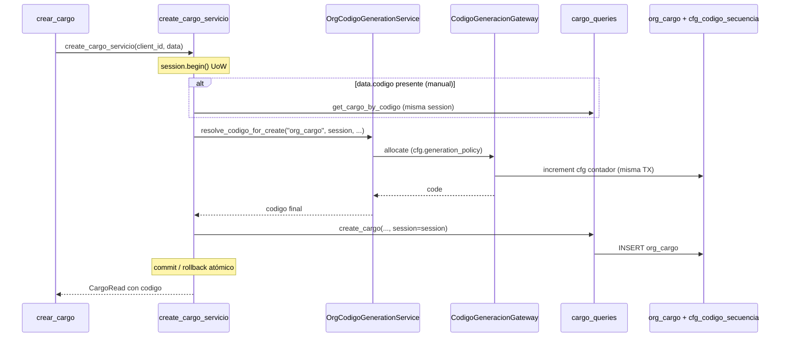

# Ola 1.2 — org_cargo: Auditoría funcional y arquitectónica

**Estado:** Auditoría — sin implementación  
**Fecha:** 2026-07-11  
**Referencia contrato:** [`../04_FUNCTIONAL_CONTRACT.md`](../04_FUNCTIONAL_CONTRACT.md)

---

## 1. Endpoint exacto POST /org/cargos

| Atributo | Valor |
|----------|-------|
| **Ruta completa** | `POST /api/v1/org/cargos` |
| **Montaje** | `api_router` → `/org` → `router_cargos` → `POST ""` |
| **Archivo** | `app/modules/org/presentation/endpoints_cargos.py` |
| **Handler** | `crear_cargo` |
| **Permiso RBAC** | `org.cargo.crear` |
| **Gate sesión** | `require_org_company_erp_session` (router padre) |
| **client_id** | `Depends(get_org_session_client_id)` — impersonación-safe |
| **Status éxito** | `201 Created` |
| **response_model** | `CargoRead` |

**Dependencias router padre** (`endpoints.py`):

```python
router.include_router(
    router_cargos,
    prefix="/cargos",
    dependencies=[Depends(require_org_company_erp_session)],
)
```

---

## 2. Flujo completo endpoint → INSERT (AS-IS)

```mermaid
sequenceDiagram
    participant FE as Frontend
    participant EP as endpoints_cargos.crear_cargo
    participant SVC as cargo_service.create_cargo_servicio
    participant CO as company_scope helpers
    participant Q as cargo_queries
    participant DB as SQL Server org_cargo

    FE->>EP: POST /api/v1/org/cargos + CargoCreate
    EP->>SVC: create_cargo_servicio(client_id, data)
    SVC->>CO: enforce_body_empresa_matches_session(data.empresa_id)
    SVC->>CO: ensure_empresa_in_tenant(client_id, empresa_id)
    SVC->>Q: get_cargo_by_codigo(client_id, empresa_id, data.codigo)
    alt duplicado
        SVC-->>FE: ConflictError 409
    end
    SVC->>SVC: payload = data.model_dump(); payload.empresa_id = empresa_id
    SVC->>Q: create_cargo(client_id, payload)
    Q->>DB: execute_insert(INSERT org_cargo) + commit implícito
    Q->>Q: get_cargo_by_id (nueva sesión)
    SVC->>CO: assert_row_empresa(row, empresa_id)
    SVC-->>EP: CargoRead
    EP-->>FE: 201 CargoRead
```

### Flujo TO-BE (Ola 1.2 — diseño)



---

## 3. Schemas Create y Read

### CargoCreate (AS-IS)

| Campo | Tipo | Required | Normalización |
|-------|------|----------|---------------|
| `empresa_id` | UUID | **Sí** | Validado vs sesión JWT |
| `codigo` | str max 20 | **Sí** | `normalize_upper` |
| `nombre` | str max 100 | Sí | strip |
| `moneda_salarial` | UUID | Sí | — |
| … | opcionales | No | ver `schemas.py` |

**Archivo:** `app/modules/org/presentation/schemas.py` L504–520

### CargoRead (AS-IS)

Incluye `cargo_id`, `cliente_id`, `empresa_id`, `codigo`, `nombre`, …, `fecha_creacion`.

**Sin cambio previsto en Read** — `codigo` siempre presente en respuesta.

### Evolución TO-BE (OpenAPI)

| Schema | Campo | AS-IS | TO-BE Ola 1.2 |
|--------|-------|-------|---------------|
| `CargoCreate` | `codigo` | `required` | **`Optional[str]`** |
| `CargoUpdate` | `codigo` | optional | sin cambio |
| `CargoRead` | `codigo` | required | sin cambio |

---

## 4. ¿Dónde se solicita hoy el código manual?

| Capa | Mecanismo |
|------|-----------|
| **OpenAPI / Pydantic** | `CargoCreate.codigo: str = Field(...)` — **obligatorio en contrato** |
| **Frontend** | Formulario alta con input código requerido (contrato AS-IS) |
| **Service** | Usa `data.codigo` directamente del body — **no hay generación** |
| **Motor** | **No consumido** |

No existe path alternativo de generación automática hoy.

---

## 5. ¿Dónde se valida actualmente?

| Validación | Ubicación | Tipo |
|------------|-----------|------|
| Formato / normalización | `_CargoWriteMixin._upper_cargo` | Pydantic `normalize_upper` |
| Campos texto | `_strip_cargo` | Pydantic |
| `empresa_id` vs sesión | `enforce_body_empresa_matches_session` | Service |
| Empresa existe en tenant | `ensure_empresa_in_tenant` | Service |
| Unicidad código | `get_cargo_by_codigo` pre-INSERT | Service → 409 |
| Scope fila post-INSERT | `assert_row_empresa` | Service |
| Longitud / NOT NULL | SQL + tabla | DDL `codigo NVARCHAR(20) NOT NULL` |
| UNIQUE | `UQ_cargo_codigo (cliente_id, empresa_id, codigo)` | SQL Server |

**Motor (`CodeValidator`, `PolicyResolver`):** no invocado hoy.

---

## 6. ¿Dónde se verifica duplicidad?

**Único pre-check aplicativo:**

```python
# cargo_service.py L100-103
if await get_cargo_by_codigo(client_id, empresa_id, data.codigo):
    raise ConflictError(
        detail=f"Ya existe un cargo con el código '{data.codigo}' en esta empresa.",
    )
```

**UPDATE:** mismo patrón con `exclude_id=cargo_id` (L125–130).

**Red de seguridad SQL:** `UQ_cargo_codigo` — debe mapearse a 409 si INSERT falla por UNIQUE (hoy no hay catch explícito en query).

---

## 7. Query INSERT real

**Archivo:** `app/infrastructure/database/queries/org/cargo_queries.py`

```python
async def create_cargo(client_id: UUID, data: Dict[str, Any]) -> Dict[str, Any]:
    payload = {k: v for k, v in data.items() if k in _COLUMNS}
    payload["cliente_id"] = client_id
    payload.setdefault("cargo_id", uuid4())
    empresa_id = payload["empresa_id"]
    stmt = insert(OrgCargoTable).values(**payload)
    await execute_insert(stmt, client_id=client_id)
    return await get_cargo_by_id(client_id, payload["cargo_id"], empresa_id=empresa_id)
```

**Tabla:** `org_cargo` (`OrgCargoTable`) — `tables_erp/tables_org.py` L260–285

---

## 8. ¿La query soporta AsyncSession externa?

| Función | `session` param | Veredicto |
|---------|-----------------|-----------|
| `list_cargos` | No | Legacy `execute_query` |
| `get_cargo_by_id` | No | Legacy |
| `get_cargo_by_codigo` | No | Legacy |
| **`create_cargo`** | **No** | **Solo `execute_insert` + commit implícito** |
| `update_cargo` | No | Legacy |

**Comparación:** `empresa_queries.create_empresa` **sí** acepta `session: Optional[AsyncSession]` (UoW-1 implementado).

**Conclusión:** cargo **requiere** extensión dual-path antes de integrar motor.

---

## 9. ¿UoW como org_empresa?

### **Sí — obligatorio**

| Razón | Detalle |
|-------|---------|
| Contador motor | `allocate` incrementa `cfg_codigo_secuencia.ultimo_numero` |
| Atomicidad | Sin UoW: contador consumido + INSERT fallido = drift |
| Patrón referencia | `create_empresa_servicio` L106–130 |

**Patrón normativo:**

```python
async with get_connection_for_tenant(client_id, OPERATION_CLASS_TENANT_DATA) as session:
    async with session.begin():
        codigo = await OrgCodigoGenerationService.resolve_codigo_for_create(
            "org_cargo", session=session, client_id=client_id, empresa_id=empresa_id,
            manual_code=data.codigo,
        )
        if data.codigo:  # pre-check solo si manual explícito
            ...
        row = await create_cargo(client_id, payload, session=session)
```

**Queries a extender (mínimo):** `create_cargo`, `get_cargo_by_id`, `get_cargo_by_codigo`.

---

## 10. Cambios OpenAPI

| Elemento | Cambio |
|----------|--------|
| `CargoCreate.codigo` | De required → **optional** |
| Descripción operación POST | Documentar auto-generación AUTO_DEFAULT |
| `CargoRead` | Sin cambio |
| Rutas / permisos / tags | Sin cambio |
| Códigos error nuevos | 422 `MANUAL_NOT_ALLOWED` (no aplica AUTO_DEFAULT sin manual) |
| | 404 `CFG_SEQUENCE_NOT_FOUND` si cfg ausente (entorno mal sembrado) |

---

## 11. Cambios frontend (posterior)

| Pantalla | AS-IS | TO-BE |
|----------|-------|-------|
| Alta cargo | Input código **obligatorio** | **Eliminar** del formulario principal |
| Post-create | — | Mostrar `codigo` asignado (solo lectura) |
| Listado / buscar | Columna código | **Sin cambio** |
| Edición | Código editable | Sin cambio Ola 1.2 (transición) |
| Implantación avanzada | — | Opcional: sección colapsada «Código manual» |

**Coordinación release:** backend optional + frontend sin input en **misma ventana** (Fase T1 contrato funcional).

---

## 12. Motor — binding técnico org_cargo

| Atributo | Valor |
|----------|-------|
| `sequence_key` | `org_cargo` |
| `scope` | EMPRESA |
| `generation_policy` (cfg) | `AUTO_DEFAULT` (sembrado bootstrap) |
| Prefijo efectivo | `CAR` + padding 3 |
| Ejemplo | `CAR001`, `CAR002` |
| Helper ORG | `OrgCodigoGenerationService.resolve_codigo_for_create` (**congelado**) |

**Autoridad runtime:** `cfg_codigo_secuencia.generation_policy` (motor P2).
