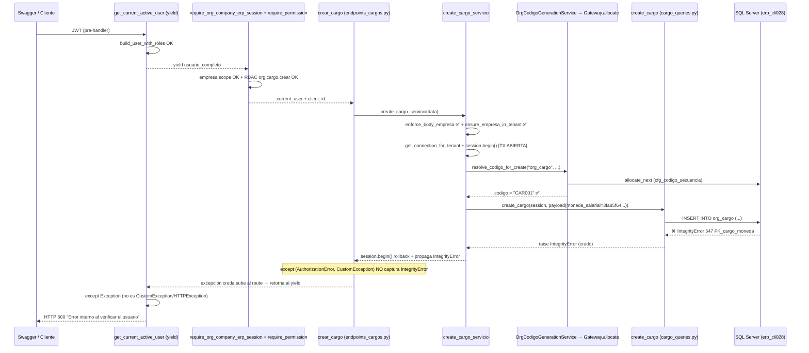

# Auditoría de incidente — `500` en `POST /api/v1/org/cargos`

**Tipo:** Diagnóstico técnico (solo lectura) — sin cambios de código
**Fecha:** 2026-07-12
**Contexto:** Cierre del piloto Ola 1.2 (`org_cargo` como primer consumidor del Motor de Códigos)
**Síntoma reportado:** `HTTP 500` → `{ "detail": "Error interno al verificar el usuario" }`
**Evidencia runtime:** `terminals/1.txt` — contenedor `fastapi_backend`, base `erp_cli028`

---

## 1. Resumen ejecutivo

| Campo | Valor |
|-------|-------|
| **Síntoma HTTP** | `500` — `"Error interno al verificar el usuario"` |
| **Excepción real** | `sqlalchemy.exc.IntegrityError` (`pyodbc.IntegrityError`, SQL Server `547`) |
| **Restricción violada** | `FK_cargo_moneda` → `cat_moneda(moneda_id)` |
| **Valor culpable** | `moneda_salarial = 3fa85f64-5717-4562-b3fc-2c963f66afa6` (UUID **de ejemplo por defecto de Swagger**, inexistente en `cat_moneda`) |
| **Punto de fallo real** | `INSERT INTO org_cargo` — `create_cargo` (`cargo_queries.py`) dentro de `session.begin()` |
| **Punto donde se genera el mensaje** | `app/api/deps.py` **L386–389** (`get_current_active_user`, dependencia `yield`) |
| **¿Relación con el Motor de Códigos?** | **No.** El motor ejecutó correctamente y produjo `codigo='CAR001'`; el fallo es **posterior**, en el `INSERT` por FK de moneda |
| **¿Introducido por Ola 1.2?** | **No.** Es un problema **funcional preexistente** de ORG (dato maestro inexistente) + mensaje engañoso compartido de `deps.py` |
| **Clasificación** | **Dato de prueba inválido** (FK) + **manejo de error genérico** en dependencia `yield` (mensaje incorrecto) |

**Conclusión:** El endpoint funciona; el motor funciona. El `500` lo provoca un `moneda_salarial` que **no existe** en `cat_moneda` (el placeholder que Swagger rellena por defecto). El mensaje "Error interno al verificar el usuario" es un **efecto colateral** conocido de `get_current_active_user` (misma causa raíz documentada en `ROLE_DEACTIVATE_500_RUNTIME_ROOT_CAUSE.md`): cualquier excepción **cruda** (no `CustomException`, no `HTTPException`) que escape del handler retorna al `yield` de la dependencia y se convierte en ese `500` genérico.

---

## 2. Evidencia runtime (literal)

```text
fastapi_backend | sqlalchemy.exc.IntegrityError: (pyodbc.IntegrityError) ('23000',
  '[23000] [Microsoft][ODBC Driver 18 for SQL Server][SQL Server]The INSERT statement
   conflicted with the FOREIGN KEY constraint "FK_cargo_moneda". The conflict occurred
   in database "erp_cli028", table "dbo.cat_moneda", column 'moneda_id'. (547) (SQLExecDirectW)')
fastapi_backend | [SQL: INSERT INTO org_cargo (cargo_id, cliente_id, empresa_id, codigo,
   nombre, ..., moneda_salarial, ...) VALUES (?, ?, ?, ?, ?, ...)]
fastapi_backend | [parameters: (UUID('e2ff5c2a-...'), UUID('7fbb2264-...'),
   UUID('22d0fb55-...'), 'CAR001', 'PRUEBA', ..., UUID('3fa85f64-5717-4562-b3fc-2c963f66afa6'), ...)]
fastapi_backend | INFO: 172.18.0.1:58246 - "POST /api/v1/org/cargos HTTP/1.1" 500 Internal Server Error
```

Observaciones clave:
- **`codigo='CAR001'` ya está en el `INSERT`** → el Motor de Códigos **sí se ejecutó** y resolvió el código **antes** del fallo.
- El `moneda_salarial` enviado es `3fa85f64-5717-4562-b3fc-2c963f66afa6`, el **UUID de ejemplo estándar de OpenAPI/Swagger** (`3fa85f64-5717-4562-b3fc-2c963f66afa6`), que no corresponde a ninguna fila real de `cat_moneda` del tenant.

---

## 3. DDL relevante — `org_cargo`

```415:457:app/bootstrap_v2/01_schema/V010__tablas_bd_erp_completo.sql
CREATE TABLE org_cargo (
    ...
    moneda_salarial UNIQUEIDENTIFIER NOT NULL,
    ...
    CONSTRAINT FK_cargo_empresa FOREIGN KEY (empresa_id)
        REFERENCES org_empresa(empresa_id) ON DELETE NO ACTION,
    CONSTRAINT FK_cargo_dpto FOREIGN KEY (departamento_id)
        REFERENCES org_departamento(departamento_id) ON DELETE NO ACTION,
    CONSTRAINT FK_cargo_jefe FOREIGN KEY (cargo_jefe_id)
        REFERENCES org_cargo(cargo_id) ON DELETE NO ACTION,
    CONSTRAINT UQ_cargo_codigo UNIQUE (cliente_id, empresa_id, codigo),
    CONSTRAINT FK_cargo_moneda FOREIGN KEY (moneda_salarial)
        REFERENCES cat_moneda(moneda_id) ON DELETE NO ACTION
);
```

`moneda_salarial` es **`NOT NULL` + FK obligatoria** a `cat_moneda`. Es la única FK obligatoria "de catálogo externo" del alta de cargo (empresa ya se valida antes; `departamento_id`/`cargo_jefe_id` son nulables).

---

## 4. Stack completo del flujo



Frames confirmados en el log (parte baja del traceback): `create_cargo` → `session.execute(INSERT)` → SQLAlchemy `_execute_context` → `aioodbc` → `pyodbc.IntegrityError (547)`.

---

## 5. Mecanismo del mensaje engañoso

```364:389:app/api/deps.py
    except HTTPException as exc:
        ...
        raise
    except Exception as e:
        from app.core.exceptions import CustomException
        ...
        if isinstance(e, CustomException):
            raise
        logger.error(f"Error inesperado obteniendo usuario activo '{username}': {e}", exc_info=True)
        raise HTTPException(
            status_code=status.HTTP_500_INTERNAL_SERVER_ERROR,
            detail="Error interno al verificar el usuario",
        )
```

`get_current_active_user` es una dependencia con `yield`. En FastAPI, toda excepción lanzada por el handler **después** del `yield` se re-propaga **dentro** del generador, en la línea del `yield`, y cae en este `except Exception`. Como `IntegrityError` **no** es `HTTPException` ni `CustomException`, se transforma en el `500` genérico "verificar el usuario". El mensaje **no describe** el fallo real (INSERT de cargo).

El endpoint solo neutraliza errores de dominio:

```81:84:app/modules/org/presentation/endpoints_cargos.py
    try:
        return await cargo_service.create_cargo_servicio(client_id=client_id, data=data)
    except (AuthorizationError, CustomException) as e:
        raise HTTPException(status_code=e.status_code, detail=e.detail) from e
```

`IntegrityError` (crudo de SQLAlchemy) queda fuera de ese `except`, por lo que escapa hacia el `yield`.

---

## 6. Respuestas a las preguntas obligatorias

**1. ¿Archivo y línea exacta del mensaje?**
`app/api/deps.py` **L386–389**, dentro de `get_current_active_user` (bloque `except Exception`). El detalle literal `"Error interno al verificar el usuario"` está en **L388**.

**2. Stack completo (POST → excepción):**
`POST /api/v1/org/cargos`
→ `require_org_company_erp_session` (gate, OK) + `require_permission("org.cargo.crear")` (RBAC, OK) + `get_org_session_client_id` (OK)
→ `crear_cargo` (`endpoints_cargos.py` L74–84)
→ `cargo_service.create_cargo_servicio` (L103–148)
→ `enforce_body_empresa_matches_session` (OK) + `ensure_empresa_in_tenant` (OK)
→ `session.begin()` (TX abierta)
→ `OrgCodigoGenerationService.resolve_codigo_for_create` → `CodigoGeneracionGateway.allocate` → **OK, `codigo='CAR001'`**
→ `create_cargo` (`cargo_queries.py`) → `session.execute(INSERT)`
→ SQL Server rechaza `INSERT` por `FK_cargo_moneda` → `pyodbc.IntegrityError (547)` → `sqlalchemy.exc.IntegrityError`
→ propaga cruda por el servicio (rollback en `session.begin()`) y el endpoint (no la captura)
→ retorna al `yield` de `get_current_active_user` → `except Exception` → **HTTP 500 "Error interno al verificar el usuario"**.

**3. ¿Alcanza `resolve_codigo_for_create()`?**
**Sí.** Se ejecutó completo: el `INSERT` ya lleva `codigo='CAR001'`, que solo puede provenir del motor.

**4. ¿Alcanza `CodigoGeneracionGateway.allocate()`?**
**Sí, y con éxito.** `resolve_codigo_for_create` invoca `Gateway.allocate`, que resolvió el código (`AUTO_GENERATE`/`ACCEPT_MANUAL`) sin error. El fallo es **posterior** al motor.

**5. ¿`AsyncSession` y `session.begin()` ya estaban abiertos?**
**Sí.** El `INSERT` ocurre dentro de `async with session.begin():`. Al fallar, el context manager hace **rollback** y re-lanza la excepción. No hubo commit; **no se creó el cargo**.

**6. ¿Antes o después del pre-check de empresa?**
**Después.** `enforce_body_empresa_matches_session` y `ensure_empresa_in_tenant` se ejecutaron y pasaron **antes** del `INSERT`.

**7. ¿Antes o después del pre-check de permisos?**
**Después.** RBAC (`require_permission("org.cargo.crear")`) se resuelve como dependencia **antes** del handler; ya había pasado.

**8. ¿Antes o después de validar usuario de sesión?**
**Después.** `get_current_active_user` ya había hecho `yield usuario_completo` (usuario válido). El error surge en la fase de handler y "regresa" al `yield`.

**9. ¿Qué componente genera realmente la excepción?**
La excepción **subyacente** la genera **SQL Server** (motor de base de datos), materializada como `sqlalchemy.exc.IntegrityError`/`pyodbc.IntegrityError (547)` al ejecutar el `INSERT` de `create_cargo`. El **mensaje HTTP** lo genera `get_current_active_user` (`deps.py` L386–389). **No** lo genera el Motor de Códigos.

**10. ¿Preexistente o introducido por Ola 1.2?**
**Preexistente.** Es una violación de FK por dato maestro inexistente + el patrón de mensaje engañoso de `deps.py` (documentado desde 2026-06-01 en `ROLE_DEACTIVATE_500_RUNTIME_ROOT_CAUSE.md`). Ola 1.2 no introdujo ni la FK ni el manejo de errores de `deps.py`.

**11. ¿Reproducible con la versión anterior del servicio (sin motor)?**
**Sí, idénticamente.** El servicio previo también hacía `INSERT INTO org_cargo` con `moneda_salarial`; un UUID inexistente disparaba el mismo `IntegrityError` crudo, no capturado (el `except` previo tampoco atrapaba errores de BD crudos) → mismo `500` "verificar el usuario". La única diferencia: antes fallaba con auto-commit; ahora con rollback dentro de `session.begin()` (comportamiento **mejor**, sin filas huérfanas).

**12. ¿El UUID de `moneda_salarial` provoca el mensaje, o el campo aún no se evaluó?**
**Lo provoca directamente.** El campo **sí se evalúa**: se envía al `INSERT` y SQL Server valida la FK `FK_cargo_moneda`. El valor `3fa85f64-5717-4562-b3fc-2c963f66afa6` (placeholder de Swagger) no existe en `cat_moneda` → violación FK → `500`. El campo se evalúa **al final** (en el `INSERT`), después del motor.

**13. ¿Dependencia obligatoria que Swagger no satisface fácilmente?**
**Sí:** `moneda_salarial` (FK `NOT NULL` a `cat_moneda`). Requiere un `moneda_id` **real** del tenant, imposible de adivinar; Swagger rellena un UUID de ejemplo inválido. Prerrequisitos del alta:
- Sesión ERP con **empresa activa** en JWT (`require_org_company_erp_session`).
- **`org_empresa`** existente y perteneciente al tenant (`ensure_empresa_in_tenant`).
- Fila **`cfg_codigo_secuencia`** para `org_cargo`/empresa (motor `AUTO_DEFAULT`).
- **`cat_moneda`** con al menos una moneda válida cuyo `moneda_id` se envíe en el body.
- Opcionales (si se envían): `departamento_id` (`org_departamento`), `cargo_jefe_id` (`org_cargo`).

**14. ¿Es `POST /org/cargos` buen candidato para pruebas manuales por Swagger?**
**Es mal candidato aislado.** Depende de estado funcional del ERP (empresa en sesión + `cat_moneda` poblada + cfg de secuencia). Para prueba manual es imprescindible **obtener antes** un `moneda_id` real (`GET` de catálogo de monedas) y una empresa válida. Es mejor cubrirlo con **tests de integración** con fixtures/seed controlados (ya existen tests unitarios que mockean la BD).

**15. ¿Continuar la migración o resolver esto primero?**
**Continuar la migración** de `departamento`, `centro_costo`, `sucursal` y `empresa`. El incidente **no bloquea** la Ola 1; es un problema de **dato de prueba** + un **mensaje de error genérico transversal** ajeno al motor.

**16. Justificación técnica (si se continúa):**
- El fallo es **posterior** al motor y **posterior** al `INSERT`; el motor quedó validado (`codigo='CAR001'` generado, allocate OK).
- La causa (FK de dato maestro inexistente) es **específica del catálogo de cargo** (`cat_moneda`), no del pipeline de códigos ni de la UoW. `session.begin()` incluso **mejora** el comportamiento (rollback atómico, sin cargo huérfano).
- El mensaje engañoso proviene de `deps.py` (dependencia compartida por **todo** el backend autenticado); es un tema transversal, no un regreso de ORG ni de Ola 1.2.
- Las demás entidades ORG replican el **mismo patrón** dual-path + UoW + motor ya probado; su migración es independiente de este dato de prueba.

**17. Si se detuviera (no recomendado), ¿qué corregir?**
No requiere corrección para avanzar. Como **hardening opcional** (fuera de Ola 1.2, en tarea aparte):
- **(a) Mapear FK a error de dominio:** capturar `IntegrityError` en `create_cargo_servicio` y traducir la violación de `FK_cargo_moneda` a `ValidationError`/`ConflictError` (422/409) con mensaje claro ("moneda no válida"). Elimina el `500` engañoso para este caso.
- **(b) Pre-check de `moneda_salarial`** contra `cat_moneda` dentro de la UoW antes del `INSERT` (opcional; la FK ya garantiza integridad).
- **(c) Hardening de `deps.py`** (transversal, backlog): no convertir excepciones del route posteriores al `yield` en "Error interno al verificar el usuario" (re-lanzar o acotar el `except`). Ya recomendado en `ROLE_DEACTIVATE_500_RUNTIME_ROOT_CAUSE.md` §10.2.

---

## 7. Veredicto

| Pregunta | Respuesta |
|----------|-----------|
| ¿El `500` es del Motor de Códigos? | **No** — el motor resolvió `CAR001` correctamente |
| ¿Causa raíz? | `moneda_salarial` inexistente en `cat_moneda` → `FK_cargo_moneda` (547) |
| ¿Introducido por Ola 1.2? | **No** — preexistente (dato + `deps.py`) |
| ¿Reproducible sin motor? | **Sí**, idéntico |
| ¿Bloquea la migración ORG? | **No** |
| ¿Se creó el cargo? | **No** — rollback vía `session.begin()` |
| Recomendación | **Continuar** con `departamento`, `centro_costo`, `sucursal`, `empresa` |

---

## 8. Referencias de código

| Archivo | Rol en el incidente |
|---------|---------------------|
| `app/api/deps.py` L386–389 | Genera el mensaje HTTP 500 engañoso (dependencia `yield`) |
| `app/modules/org/presentation/endpoints_cargos.py` L74–84 | `crear_cargo`; `except` solo atrapa `CustomException`/`AuthorizationError` |
| `app/modules/org/application/services/cargo_service.py` L103–148 | `create_cargo_servicio`; UoW + motor; sin captura de `IntegrityError` |
| `app/infrastructure/database/queries/org/cargo_queries.py` `create_cargo` | Ejecuta el `INSERT` que dispara la FK |
| `app/core/codigo/gateway/codigo_generacion_gateway.py` L62–95 | `allocate` — ejecutó OK (fuera de culpa) |
| `app/bootstrap_v2/01_schema/V010__...sql` L415–457 | DDL `org_cargo` + `FK_cargo_moneda` |
| `terminals/1.txt` L47–51 | Evidencia runtime (IntegrityError 547 + HTTP 500) |

**Relacionado:** `app/docs/auditoria/ROLE_DEACTIVATE_500_RUNTIME_ROOT_CAUSE.md` (mismo patrón de mensaje engañoso en `get_current_active_user`).
