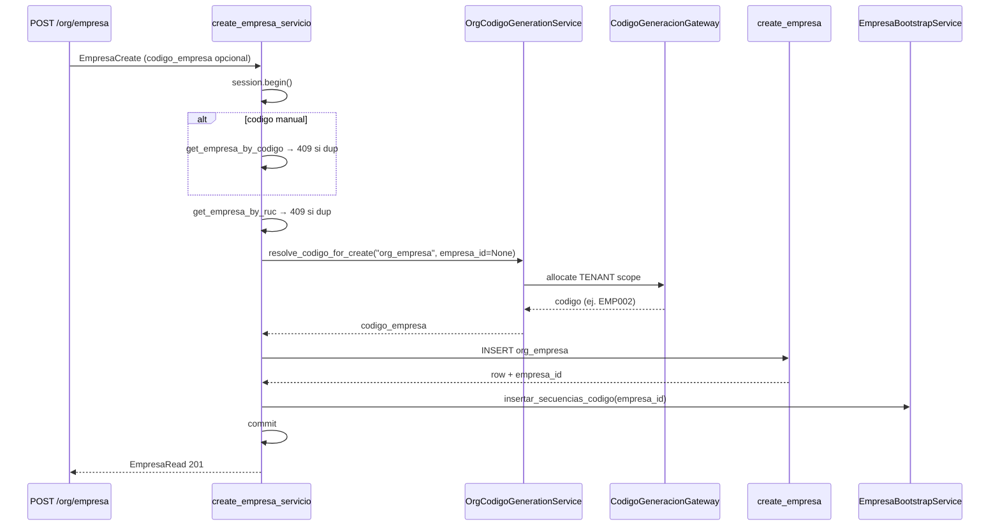

# Auditoría de integración — `org_empresa` (respuestas obligatorias 1–20)

**Tipo:** Auditoría técnica AS-IS (integración ORG)  
**Fecha:** 2026-07-12  
**Bootstrap EMP001 / contador:** decisión **cerrada** — ver normativa `BR-BOOT-04`, `BR-M-02` (`code-generation/07`, `bootstrap/03` §2.1). §§9–11 describen AS-IS pre-implementación seed; TO-BE = `ultimo_numero=1`.

**Referencias AS-IS:** `empresa_service.py`, `empresa_queries.py`, `EmpresaBootstrapService`, `TenantBootstrapOrchestrator`, `MinimalErpTenantBootstrapService`, `SequenceCatalog` (`org_empresa`), docs Ola 1 previas.

---

## 1. ¿Qué diferencias existen entre `org_empresa` y las cuatro entidades company-scoped ya migradas?

| # | Dimensión | Company-scoped (cargo, dpto, CC, sucursal) | `org_empresa` |
|---|-----------|--------------------------------------------|---------------|
| 1 | **Scope motor** | `ScopeType.EMPRESA` — `empresa_id` obligatorio en `GenerationContext` | `ScopeType.TENANT` — `empresa_id=None` en cfg y contexto |
| 2 | **Campo de negocio** | `codigo` | `codigo_empresa` |
| 3 | **sequence_key** | `org_cargo`, `org_departamento`, etc. | `org_empresa` |
| 4 | **Prefijo catálogo** | CAR, DEP, CC, SUC | **EMP** |
| 5 | **Session gate router** | `require_org_company_erp_session` | `require_org_tenant_erp_session` |
| 6 | **Validación empresa sesión** | `enforce_body_empresa_matches_session` | **No aplica** — recurso tenant-wide |
| 7 | **Pre-check dominio** | `ensure_empresa_in_tenant` | **Unicidad RUC** por tenant (`get_empresa_by_ruc`) |
| 8 | **Post-INSERT** | Ninguno | **`insertar_secuencias_codigo`** → 56 filas cfg EMPRESA |
| 9 | **UoW en queries** | Implementado en Ola 1.2 | **Ya implementado** en UoW-1 (2026-07-10) |
| 10 | **Onboarding dedicado** | No | **`ensure_empresa_inicial`** crea EMP001 sin motor |
| 11 | **Contador cfg** | Una fila por empresa (scope EMPRESA) | **Una fila TENANT compartida** para todas las empresas del cliente |
| 12 | **Endpoint** | `/org/cargos`, `/departamentos`, etc. | `/org/empresa` |
| 13 | **RBAC crear** | `org.{recurso}.crear` | `org.empresa.crear` |

**Conclusión:** `org_empresa` no es una réplica mecánica del patrón company-scoped; comparte UoW + `OrgCodigoGenerationService`, pero añade **scope TENANT**, **RUC**, **bootstrap cfg EMPRESA** y **convivencia EMP001**.

---

## 2. ¿Qué partes de `create_empresa_servicio` fueron modificadas previamente?

### UoW-1 (ORG Unit of Work — empresa)

| Cambio | Estado actual |
|--------|---------------|
| `get_connection_for_tenant(client_id, OPERATION_CLASS_TENANT_DATA)` | ✅ Presente L106–108 |
| `async with session.begin():` | ✅ Presente L109 |
| Dual-path en `get_empresa_by_codigo`, `get_empresa_by_ruc`, `create_empresa`, `get_empresa_by_id` | ✅ `empresa_queries.py` |
| Pre-checks codigo/RUC **dentro** de la TX con `session=session` | ✅ L110–124 |
| Eliminación de auto-commit aislado en create | ✅ |

**Evidencia:** `tests/unit/test_org_empresa_uow.py`, diseño en `empresa-bootstrap-v1/02_ORG_UNIT_OF_WORK_DESIGN.md`.

### UoW-2 (integración bootstrap en misma TX)

| Cambio | Estado actual |
|--------|---------------|
| Invocación `EmpresaBootstrapService.insertar_secuencias_codigo` **dentro** de `session.begin()` | ✅ L128–130 |
| Rollback conjunto empresa + cfg si seed falla | ✅ Verificado en `test_org_empresa_bootstrap_v1.py` |
| `create_empresa_servicio` **no** llama `ensure_empresa_inicial` | ✅ Test `test_org_create_does_not_call_ensure_empresa_inicial` |

### Empresa Bootstrap V1

| Cambio | Estado actual |
|--------|---------------|
| Post-INSERT: seed cfg scope **EMPRESA** para nuevo `empresa_id` | ✅ vía `seed_cfg_empresa` |
| Conexión `OPERATION_CLASS_TENANT_DATA` (Shared + Dedicated) | ✅ Test dedicado |
| **No** re-seed cfg TENANT en create ORG | ✅ Solo EMPRESA-scoped rows |
| `generation_policy` persistida en insert | ✅ Repo + catálogo |

**AS-IS `create_empresa_servicio` (L100–134):**

```python
async with get_connection_for_tenant(...) as session:
    async with session.begin():
        if await get_empresa_by_codigo(..., session=session): raise ConflictError
        if await get_empresa_by_ruc(..., session=session): raise ConflictError
        row = await create_empresa(..., session=session)
        await EmpresaBootstrapService.insertar_secuencias_codigo(session, client_id, row["empresa_id"])
```

**Pendiente Ola 1 motor:** integrar `resolve_codigo_for_create("org_empresa", ...)` y `EmpresaCreate.codigo_empresa` Optional.

---

## 3. ¿En qué punto exacto invocar `resolve_codigo_for_create("org_empresa", ...)`?

**Ubicación normativa:** dentro de `session.begin()`, **después** de pre-checks de unicidad y **antes** de `create_empresa`.

```python
async with session.begin():
    manual = _normalize_manual_codigo(data.codigo_empresa)
    if manual and await get_empresa_by_codigo(client_id, manual, session=session):
        raise ConflictError(...)
    if await get_empresa_by_ruc(client_id, data.ruc, session=session):
        raise ConflictError(...)
    codigo_empresa = await OrgCodigoGenerationService.resolve_codigo_for_create(
        "org_empresa",
        session=session,
        client_id=client_id,
        empresa_id=None,  # TENANT scope
        manual_code=manual,
    )
    payload = data.model_dump()
    payload["codigo_empresa"] = codigo_empresa
    row = await create_empresa(client_id=client_id, data=payload, session=session)
    await EmpresaBootstrapService.insertar_secuencias_codigo(session, client_id, row["empresa_id"])
```

**Parámetros críticos:**
- `sequence_key="org_empresa"`
- `empresa_id=None` (TENANT — no confundir con `empresa_id` de la fila insertada)
- `manual_code` = código normalizado del body (o `None` para auto)

---

## 4. ¿Antes o después de validar RUC?

**Después del pre-check RUC** (recomendado — orden actual preservado).

| Orden | Paso | Motivo |
|-------|------|--------|
| 1 | Duplicate `codigo_empresa` (solo si manual) | Evitar allocate innecesario |
| 2 | Duplicate **RUC** | Validación de negocio independiente del motor |
| 3 | **`resolve_codigo_for_create`** | Consume contador solo si RUC/código manual OK |
| 4 | INSERT | — |

Invertir RUC después de allocate desperdiciaría contador en tenant con RUC duplicado (rollback lo revertiría, pero es anti-patrón).

---

## 5. ¿Antes o después del duplicate check de `codigo_empresa`?

| Escenario | Momento duplicate check | Momento allocate |
|-----------|-------------------------|------------------|
| **Código manual** | **Antes** de allocate | Después del check |
| **Código omitido (auto)** | No hay pre-check local | Allocate genera código; unicidad garantizada por motor + UNIQUE BD |

Mismo patrón que cargo/departamento/CC/sucursal: pre-check local **solo** cuando el cliente envía código manual.

---

## 6. ¿Antes o después del INSERT de `org_empresa`?

**Antes del INSERT.** El código resuelto debe ir en el payload de `create_empresa`.

El motor **asigna** el código; la query **persiste** la fila. No existe flujo válido post-INSERT para auto-generación en CREATE.

---

## 7. ¿Antes o después de `insertar_secuencias_codigo()`?

**Antes.** Secuencia obligatoria:

1. allocate → `codigo_empresa` definitivo  
2. INSERT `org_empresa` → obtiene `empresa_id`  
3. `insertar_secuencias_codigo(session, client_id, empresa_id)` → filas cfg **EMPRESA** para la nueva empresa  

El bootstrap cfg EMPRESA depende del `empresa_id` generado en el INSERT. El motor TENANT `org_empresa` numera **empresas**, no secuencias hijas.

---

## 8. ¿El código generado debe persistirse dentro del mismo `session.begin()` existente?

**Sí — obligatorio.**

| Operación | Misma sesión | Misma TX |
|-----------|--------------|----------|
| allocate (contador TENANT) | ✅ | ✅ |
| INSERT org_empresa | ✅ | ✅ |
| seed cfg EMPRESA | ✅ | ✅ |

Ya cumplido arquitectónicamente; la integración del motor debe **entrar** en el bloque existente, no abrir una segunda conexión.

---

## 9. ¿Existe algún punto donde el contador pudiera consumirse y perder sincronía?

| Escenario | ¿Riesgo? | Mitigación actual / propuesta |
|-----------|----------|-------------------------------|
| allocate OK → INSERT falla | **Bajo** | Rollback `session.begin()` revierte contador |
| allocate OK → bootstrap cfg falla | **Bajo** | Rollback revierte contador + INSERT (V1 probado) |
| **EMP001 onboarding sin allocate** | **ALTO** | Contador TENANT en 0; auto generaría EMP001 → colisión |
| allocate OK → commit → tenant legacy sin fila cfg TENANT | **Medio** | `NotFoundError` CFG — prerequisito onboarding |
| UPDATE manual `codigo_empresa` sin align | **Medio** | Fuera CREATE Ola 1; backlog align en UPDATE |
| Segunda TX post-commit | **N/A** | No aplica — todo en un `begin()` |

**Punto crítico:** desincronía **estructural** EMP001 (onboarding) vs contador cfg, no fallo de TX.

---

## 10. ¿Qué impacto tiene EMP001 generado durante onboarding sobre el contador TENANT?

| Hecho | Detalle |
|-------|---------|
| Creación EMP001 | `MinimalErpTenantBootstrapService.ensure_empresa_inicial` — SQL directo, constante `CODIGO_EMPRESA_INICIAL = "EMP001"` |
| Seed cfg TENANT | `seed_cfg_tenant` → fila `org_empresa` con `ultimo_numero=0`, `numero_inicial=1` |
| Consumo contador | **Ninguno** — EMP001 no pasó por `AllocationCoordinator.allocate_next` |
| Estado post-onboarding | Existe fila `org_empresa` con código EMP001; contador cfg sigue en **0** |
| Primer allocate auto (sin repair) | Motor emitiría **EMP001** → conflicto UNIQUE `(cliente_id, codigo_empresa)` |

**Impacto:** bloqueo funcional del primer CREATE auto post-onboarding hasta alinear contador.

---

## 11. ¿La estrategia actual continúa siendo correcta para que la siguiente empresa sea EMP002?

**Condicionalmente sí**, con precondición de alineación:

| Condición | Siguiente auto |
|-----------|----------------|
| Contador TENANT `ultimo_numero=0`, EMP001 ya existe | ❌ **EMP001** (incorrecto) |
| Contador alineado a high-water **EMP001** (`ultimo_numero≥1`) | ✅ **EMP002** |
| Cliente envía manual EMP002 | ✅ ACCEPT_MANUAL + align (catálogo `align_on_manual=True`) |

**Estrategia normativa Ola 1** (doc `03_ORG_MIGRATION_STRATEGY.md` §4): **Opción A** — repair/alineación post-onboarding **sin** modificar Bootstrap V2. Opción B (onboarding vía motor) prohibida en Ola 1.

Tests existentes ya asumen **EMP002** como segunda empresa (`test_org_empresa_bootstrap_v1.py`, `test_org_empresa_uow.py`).

---

## 12. ¿Es necesario modificar `EmpresaBootstrapService`?

**No.**

| Método | Rol | Cambio |
|--------|-----|--------|
| `insertar_secuencias_codigo` | Seed cfg EMPRESA post-INSERT | **Congelado** — sigue después del INSERT |
| `ensure_empresa_inicial` | Solo onboarding EMP001 | **Congelado** — no usar en ORG create |
| `vincular_admin_empresa` | Solo onboarding | **Congelado** |

La integración motor ocurre **antes** del INSERT; EBS no participa en numeración TENANT.

---

## 13. ¿Es necesario modificar `TenantBootstrapOrchestrator`?

**No.**

`run_seed_codigo_secuencias` (onboarding) permanece: `seed_cfg_tenant` + `insertar_secuencias_codigo` para EMP001. El flujo ORG `POST /org/empresa` **no** invoca TBO.

Test de regresión existente: `test_onboarding_seed_codigo_secuencias_unchanged_for_emp001`.

---

## 14. ¿Es necesario modificar `cfg_codigo_onboarding_seed`?

**No** para Ola 1 ORG runtime.

| Función | Cuándo | Cambio |
|---------|--------|--------|
| `seed_cfg_tenant` | Onboarding | Congelado |
| `seed_cfg_empresa` | Onboarding + EBS V1 post-create ORG | Congelado |

Un proyecto **ENSURE** futuro podría añadir repair de contador post-onboarding; queda **fuera** de Ola 1.

---

## 15. ¿Es necesario modificar `app/core/codigo`?

**No.** Motor congelado.

`org_empresa` ya está en `SequenceCatalog` (TENANT, AUTO_DEFAULT, prefijo EMP). Consumo exclusivamente vía `OrgCodigoGenerationService` → `CodigoGeneracionGateway.allocate`.

---

## 16. ¿Riesgo de regresión para Shared?

| Área | Riesgo | Notas |
|------|--------|-------|
| Conexión tenant | **Bajo** | Ya usa `OPERATION_CLASS_TENANT_DATA` — test V1 |
| Onboarding Shared | **Medio** | EMP001 path intacto; no tocar TBO |
| Segunda empresa auto | **Medio** | Depende alineación contador EMP001 |
| Company-scoped ORG | **Bajo** | Sin cambio — ya migrados |
| RBAC / endpoints | **Bajo** | Sin cambio contrato Read |

**Mitigación:** gate `test_create_empresa_servicio_uses_tenant_data_connection_for_shared_and_dedicated` + nuevo test motor TENANT scope.

---

## 17. ¿Riesgo para Dedicated?

| Área | Riesgo | Notas |
|------|--------|-------|
| Tenant store routing | **Bajo** | Mismo patrón UoW V1 validado |
| Provisioning Dedicated | **Medio** | Onboarding S7 usa TBO+EBS — no mezclar con ORG create |
| cfg seed en DB dedicada | **Bajo** | `insert_secuencia` exige session (ADJ-03) — ya cumplido |
| Contador EMP001 | **Medio** | Idéntico a Shared |

Dedicated **no** introduce patrón distinto; comparte `get_connection_for_tenant`.

---

## 18. ¿Qué nuevos tests específicos deben agregarse?

### Archivo nuevo: `tests/unit/test_org_empresa_motor_integration.py`

| # | Caso | Assert clave |
|---|------|--------------|
| 1 | create sin `codigo_empresa` | `resolve("org_empresa", empresa_id=None)` + payload con código generado |
| 2 | create con código manual | duplicate check + manual_code propagado |
| 3 | duplicate manual | ConflictError; motor no invocado |
| 4 | duplicate RUC | ConflictError; motor no invocado |
| 5 | cfg TENANT missing | NotFoundError; create no invocado |
| 6 | rollback (conflict RUC) | `create_empresa` no llamado |
| 7 | rollback (conflict codigo manual) | motor no invocado |
| 8 | single `session.begin()` | una TX |
| 9 | schema acepta codigo omitido | `EmpresaCreate` sin codigo_empresa |
| 10 | **TENANT scope** | `empresa_id=None` en llamada resolve |
| 11 | bootstrap post-insert preservado | `insertar_secuencias_codigo` después de create |
| 12 | bootstrap failure + motor | rollback; allocate no persistido |

### Ampliar existentes

| Archivo | Adición |
|---------|---------|
| `test_org_empresa_bootstrap_v1.py` | Mock motor → EMP002; verificar orden allocate → create → bootstrap |
| `test_org_empresa_uow.py` | Actualizar `test_create_empresa_servicio_uses_single_session` si payload incluye código resuelto |

### Gate E2E recomendado (staging)

- Tenant post-onboarding: POST empresa sin código → **EMP002**
- Tenant limpio multi-empresa: manual EMP003 aceptado
- Dedicated tenant: misma secuencia

---

## 19. ¿Qué componentes deben permanecer absolutamente congelados?

| Componente | Motivo |
|------------|--------|
| `app/core/codigo/**` | Motor congelado por gobernanza |
| `OrgCodigoGenerationService` | Ola 1.1 — infra ORG delgada |
| `CodigoGeneracionGateway`, `AllocationCoordinator`, `PolicyResolver`, `SequenceCatalog` | Congelados |
| `EmpresaBootstrapService` | Contrato Bootstrap V2 |
| `TenantBootstrapOrchestrator` | Onboarding Shared/Dedicated |
| `cfg_codigo_onboarding_seed.py` | SSOT seed cfg |
| `MinimalErpTenantBootstrapService.ensure_empresa_inicial` | EMP001 onboarding |
| `ClienteOnboardingService` / flujo onboarding | Fuera alcance |
| Endpoints ORG empresa | RBAC, rutas, `EmpresaRead` |
| `empresa_queries.py` dual-path | Ya correcto — no refactor |

**Modificables en Ola 1 org_empresa:** `empresa_service.create_empresa_servicio`, `EmpresaCreate.codigo_empresa` Optional, tests ORG.

---

## 20. ¿Después de implementar `org_empresa` podremos considerar oficialmente cerrada la Ola 1 ORG?

**Sí**, sujeto a cumplimiento del gate ampliado:

| Criterio | Estado |
|----------|--------|
| 5 entidades catálogo motor ORG integradas | 4/5 — falta empresa |
| `app/core/codigo` sin diff | ✅ Obligatorio |
| Patrón UoW + dual-path + motor | ✅ Empresa parcial (motor pendiente) |
| Bootstrap V1 intacto | ✅ Obligatorio |
| Gate EMP002 auto sin colisión EMP001 | ⏳ Tras seed `ultimo_numero=1` + motor ORG |
| `org_parametro_sistema` | **Fuera** Ola 1 (manual permanente) |

**Declaración de cierre:** tras merge de `org_empresa` + seed bootstrap BR-BOOT-04 + tests verdes + validación EMP002, **Ola 1 ORG — Integración Motor de Códigos** queda **oficialmente cerrada**. Evoluciones posteriores (Bootstrap V3 vía motor para EMP001, UPDATE align, preview API) son **Ola 2+**, no bloqueantes.

---

## Diagrama de flujo TARGET



---

*Plan de implementación: [`02_IMPLEMENTATION_PLAN.md`](02_IMPLEMENTATION_PLAN.md)*
