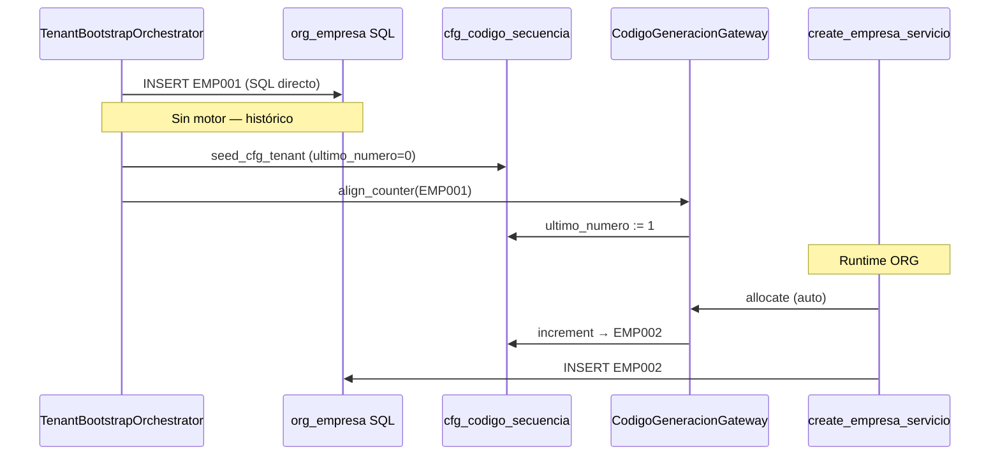

# Decisión arquitectónica — EMP001 y contador TENANT `org_empresa`

**Tipo:** Auditoría histórica — **SUPERSEDED**  
**Fecha:** 2026-07-12  
**Estado:** **CERRADA** — normativa oficial en Motor de Códigos (`BR-M-02`, `BR-BOOT-04`, `BS-CFG-02` excepción)  
**Superseded by:** `app/docs/arquitectura/code-generation/bootstrap/03_BOOTSTRAP_RULES.md` §2.1, `07_BUSINESS_RULES.md` BR-M-02

> Este documento conserva el análisis histórico (opciones ENSURE/repair/guard). **No es normativa vigente.**  
> Decisión greenfield aprobada: seed cfg `ultimo_numero=1`; sin ENSURE; sin repair runtime; sin guard en ORG create.

---

## Veredicto ejecutivo

| Pregunta | Respuesta corta |
|----------|-----------------|
| ¿Por qué EMP001 no consume el contador? | Onboarding inserta `EMP001` por SQL directo **antes** de sembrar cfg TENANT, sin invocar el motor |
| ¿Decisión consciente o ausencia de motor? | **Ambas:** bootstrap minimal ERP es anterior al motor; la documentación normativa posterior **reconoce explícitamente** el caso como excepción inicial |
| ¿Estándar oficial recomendado? | **Opción B** — alineación **única** en el límite onboarding (post-`seed_cfg_tenant`) + script **ENSURE** para legacy |
| ¿Opción A como estándar? | **No** — aceptable solo como puente Ola 1 si bootstrap/TBO siguen congelados y ENSURE no puede ejecutarse antes del primer alta |
| ¿Opción C como estándar inmediato? | **No en Ola 1** — evolución objetivo Bootstrap V3; requiere reordenar onboarding y descongelar componentes |

---

## 1. ¿Por qué EMP001 no consume actualmente el contador TENANT?

### Evidencia en cadena causal

**1.1 — EMP001 se crea sin motor**

`MinimalErpTenantBootstrapService.ensure_empresa_inicial` inserta la empresa sede con constante fija y SQL parametrizado (`text(...)`). No hay import ni llamada a `CodigoGeneracionGateway`, `OrgCodigoGenerationService`, `AllocationCoordinator` ni `CfgSequenceStore.increment_and_get`.

```21:21:app/modules/tenant/application/services/minimal_erp_tenant_bootstrap_service.py
CODIGO_EMPRESA_INICIAL = "EMP001"
```

```66:88:app/modules/tenant/application/services/minimal_erp_tenant_bootstrap_service.py
        sql = text("""
            INSERT INTO org_empresa (
                empresa_id, cliente_id, codigo_empresa, razon_social,
                ...
            )
            VALUES (
                :empresa_id, :cliente_id, :codigo_empresa, :razon_social,
                ...
            )
        """).bindparams(
            ...
            codigo_empresa=CODIGO_EMPRESA_INICIAL,
            ...
        )
        try:
            await session.execute(sql)
```

**1.2 — Orden del onboarding: empresa antes que cfg**

En `TenantBootstrapOrchestrator.orchestrate_shared_onboarding`, `run_seed_org_empresa` (→ `ensure_empresa_inicial`) ocurre en el **paso 3**; `run_seed_codigo_secuencias` (→ `seed_cfg_tenant`) en el **paso 8**, al final del flujo.

```148:181:app/modules/tenant/application/services/tenant_bootstrap_orchestrator.py
        empresa_id = await TenantBootstrapOrchestrator.run_seed_org_empresa(
            session,
            cliente_id=cliente_id,
            cliente_data=cliente_data,
        )
        ...
        await TenantBootstrapOrchestrator.run_seed_codigo_secuencias(
            session, cliente_id=cliente_id, empresa_id=empresa_id
        )
```

Incluso si el motor existiera en el momento del alta de EMP001, la fila cfg TENANT `org_empresa` **aún no existiría** en ese punto del pipeline.

**1.3 — Seed cfg TENANT arranca en cero**

`OnboardingSequenceSeed.from_definition` fija `ultimo_numero=0` para todas las secuencias sembradas. `seed_cfg_tenant` persiste ese valor vía repositorio.

```47:60:app/core/codigo/onboarding_seed.py
    ultimo_numero: int = 0
    numero_inicial: int = 1
    ...
            ultimo_numero=0,
```

```48:54:app/modules/tenant/application/services/cfg_codigo_onboarding_seed.py
async def seed_cfg_tenant(session: AsyncSession, cliente_id: UUID) -> None:
    await _seed_cfg_rows(
        session,
        cliente_id,
        empresa_id=cliente_id,
        scopes=frozenset({ScopeType.TENANT}),
    )
```

**1.4 — Primer `allocate` auto emitiría EMP001 de nuevo**

Con `ultimo_numero=0` y `numero_inicial=1`, la fórmula del store es:

```187:187:app/core/codigo/stores/cfg_sequence_store.py
        nuevo = max(row.ultimo_numero, row.numero_inicial - 1) + 1
```

→ `max(0, 0) + 1 = 1` → código formateado **`EMP001`**, colisionando con la fila ya existente en `org_empresa`.

**1.5 — Código manual tampoco consume contador en allocate**

`AllocationCoordinator.accept_manual` devuelve `consumed=False` y `ultimo_numero=None`. La alineación post-manual solo ocurre si `maybe_align` detecta parte numérica mayor que el contador actual (`align_on_manual=True` en catálogo). EMP001 nunca pasó por ese camino.

### Conclusión §1

EMP001 no consume el contador porque el onboarding **bypasea deliberadamente el motor** en un paso anterior e independiente al seed cfg, dejando `ultimo_numero=0` mientras la tabla de negocio ya contiene `EMP001`.

---

## 2. ¿Decisión consciente del diseño original o simplemente porque el motor todavía no existía?

### Respuesta: **ambos factores, documentados posteriormente como caso normativo**

| Evidencia | Interpretación |
|-----------|----------------|
| Docstring de `MinimalErpTenantBootstrapService`: *"Bootstrap ERP mínimo al crear tenant"* | Servicio **legacy/minimal** anterior a la integración del motor en runtime ORG |
| Bootstrap V2 / Strangler Fig (`EmpresaBootstrapService` como fachada de delegación) | Separación intencional: onboarding ≠ allocate runtime |
| `08_CODE_POLICIES.md` L93: *"bootstrap fijo `EMP001` es caso inicial"* | Reconocimiento **normativo explícito** de la excepción, no bug olvidado |
| `04_FUNCTIONAL_CONTRACT.md` §6.3: *"EMP001 onboarding \| Permanece; alinear contador antes de auto EMP002+ (proyecto ENSURE)"* | Contrato funcional Ola 1 asume convivencia + repair |
| `01_SEQUENCE_DEFAULT_CONFIGURATION.md` L50: primer código esperado `EMP001`, high-water **Sí** | El diseño del catálogo **prevé** high-water; el gap está en el **puente onboarding→motor**, no en la definición de secuencia |
| `INV-BOOT-04`: filas recién sembradas con `ultimo_numero=0` | Regla de seed **correcta** para filas nuevas; incompatible con EMP001 preexistente sin paso de alineación |

### Conclusión §2

- **Origen histórico:** el motor no existía cuando se diseñó el bootstrap minimal; EMP001 hardcodeado resolvía el huevo-gallina tenant→empresa→sesión.
- **Estado actual consciente:** la arquitectura de códigos **asume** EMP001 fijo en onboarding y exige **reconciliación explícita** del contador antes del primer auto EMP002+. No es un descuido; es deuda de integración **documentada y pendiente de cierre**.

---

## 3. ¿Qué responsabilidades pertenecen al onboarding y cuáles al Motor de Generación?

| Responsabilidad | Dueño | Evidencia / notas |
|-----------------|-------|-------------------|
| Crear tenant (`cliente`), roles base, admin, RBAC | **Onboarding** (`ClienteOnboardingService`, `TenantBootstrapOrchestrator`) | Flujo 8 pasos Shared |
| Crear **empresa sede** `EMP001` idempotente | **Onboarding** (`ensure_empresa_inicial`) | SQL directo, constante fija |
| Vincular admin ↔ empresa default | **Onboarding** (`vincular_admin_empresa`) | M4 tenant-wide |
| Sembrar filas `cfg_codigo_secuencia` TENANT + EMPRESA sede | **Onboarding** (`seed_cfg_tenant`, `seed_cfg_empresa`) | `ultimo_numero=0` por INV-BOOT-04 |
| Sembrar cfg EMPRESA al crear **segunda+ empresa** vía ORG | **ORG create** (`EmpresaBootstrapService.insertar_secuencias_codigo`) | Post-INSERT en UoW |
| Resolver política AUTO vs manual | **Motor** (`PolicyResolver`) | Congelado |
| Consumir contador en alta automática | **Motor** (`AllocationCoordinator.allocate_next`) | Único camino transaccional de consumo |
| Validar formato manual | **Motor** (`CodeValidator`) | vía Gateway |
| Alinear high-water tras manual/import | **Motor** (`CounterAlignmentService.maybe_align` → `align_counter`) | Catálogo `align_on_manual=True` |
| Persistir código en entidad de negocio | **Módulo ORG** (`create_empresa`, queries) | Fuera del motor |
| Garantizar coherencia contador ↔ datos existentes al **cerrar onboarding** | **Onboarding (pendiente)** o **ENSURE ops** | Hoy **no implementado** — origen del gap |

### Principio de frontera

- **Onboarding** debe dejar el tenant en estado **operable**: empresa sede + cfg mínima + contadores **consistentes con la realidad persistida**.
- **Motor** gobierna **runtime** de generación/validación/alineación; no debe compensar permanentemente omisiones del bootstrap en cada alta ORG.

---

## 4. ¿Quién debería ser realmente el dueño del "high-water mark" de `org_empresa`?

### SSOT técnico del contador

| Capa | Rol |
|------|-----|
| **`cfg_codigo_secuencia.ultimo_numero`** (scope TENANT, `sequence_key=org_empresa`) | Fuente de verdad **operativa** para el motor |
| **`org_empresa.codigo_empresa`** (datos de negocio) | Fuente de verdad **semántica** de códigos ya emitidos |
| **`CounterAlignmentService` / `CfgSequenceStore.align_counter`** | Mecanismo autorizado para elevar `ultimo_numero` cuando la realidad de negocio supera el contador |
| **`AllocationCoordinator.allocate_next`** | Mecanismo autorizado para **consumir** (incrementar) el contador en altas automáticas |

### Dueño funcional recomendado

| Momento | Dueño del high-water |
|---------|---------------------|
| **Cierre onboarding** (EMP001 ya persistido) | **Onboarding** — debe invocar alineación vía Gateway **una vez** |
| **Importación masiva / implantación** | **Servicio de importación** — vía `align_counter` en la misma UoW del lote |
| **Alta manual AUTO_DEFAULT** | **Motor** — `maybe_align` automático en `allocate` post-manual |
| **Alta automática runtime ORG** | **Motor** — `allocate_next`; **no** debe recalcular MAX desde BD en ORG |

**Regla:** el high-water **pertenece al dominio cfg/motor**; la **responsabilidad de dejarlo correcto** al terminar onboarding pertenece al **pipeline de bootstrap**, no a `create_empresa_servicio` en operación recurrente.

---

## 5. ¿Invocar `align_counter()` desde `create_empresa_servicio` rompe el principio de separación de responsabilidades?

### Análisis

| Aspecto | Evaluación |
|---------|------------|
| ¿Viola la prohibición ORG→store directo? | **No** — si se usa `CodigoGeneracionGateway.align_counter` (API pública del motor) |
| ¿Mezcla "alta de empresa" con "reparación de bootstrap"? | **Sí** — `create_empresa_servicio` asumiría deuda estructural del onboarding en cada invocación |
| ¿Es coherente con el diseño del Gateway? | **Parcialmente** — `12_GATEWAY_DESIGN.md` §5.4 lista importación masiva y post-manual, **no** create ORG rutinario |
| ¿Es coherente con Ola 1 company-scoped? | **No** — cargo/sucursal/CC/dpto **no** necesitan guard de repair en create |

### Conclusión §5

Invocar `align_counter()` desde `create_empresa_servicio` **no rompe** la capa de abstracción (Gateway vs store), pero **sí erosiona** la separación de responsabilidades **semántica**: el servicio ORG de alta pasaría a ser también **reconciliador permanente** de un artefacto que debería quedar resuelto al cerrar onboarding.

**Veredicto:** aceptable como **puente temporal Ola 1**; **inaceptable** como estándar permanente del proyecto.

---

## 6. ¿`align_counter()` fue diseñado como mecanismo permanente o solo como herramienta de reparación?

### Evidencia normativa

| Fuente | Cita / implicación |
|--------|-------------------|
| `12_GATEWAY_DESIGN.md` §5.4 | *"Ajustar `ultimo_numero` tras **importación o manual** con parte numérica alta"* |
| `11_TECHNICAL_ARCHITECTURE.md` | CounterAlignmentService: *"High-water mark **post-importación y post-manual**"* |
| `15_TRANSACTION_AND_CONCURRENCY.md` TX-05 | align en importación masiva, misma UoW del lote |
| `21_SEQUENCE_CATALOG_MATRIX.md` | Columna align: high-water en import/implantación, **no en allocate normal** |
| `Gateway.allocate` L86-94 | Alineación **automática** integrada solo en ramas manual/import |
| `Gateway.align_counter` L147-165 | API **explícita** para casos externos (import, repair, ENSURE) |

### Uso actual en código productivo

Búsqueda en `*.py` del repositorio:

| Ubicación | Uso |
|-----------|-----|
| `CfgSequenceStore.align_counter` | Implementación store |
| `CounterAlignmentService.maybe_align` | Delegación interna |
| `CodigoGeneracionGateway.align_counter` | Fachada pública |
| **Fuera de `app/core/codigo/**`** | **Ningún módulo ORG/tenant/provisioning lo invoca** |
| Tests | Mock en `test_codigo_engine_ola0.py` |

### Conclusión §6

`align_counter()` fue diseñado como **herramienta de reconciliación** (importación, manual alto, repair/ENSURE), con integración automática limitada al path manual dentro de `allocate`. **No** fue diseñado como guard obligatorio en cada `create_*` ERP rutinario.

---

## 7. ¿Existe actualmente algún otro módulo que invoque `align_counter()` durante runtime?

**No.**

| Invocación | Contexto |
|------------|----------|
| `CounterAlignmentService.maybe_align` | Solo desde `Gateway.allocate` (manual/import) y `Gateway.align_counter` |
| `CodigoGeneracionGateway.align_counter` | API disponible; **sin consumidores** en `app/modules/**`, `app/infrastructure/provisioning/**` |

Dedicated replica el mismo onboarding vía `DedicatedTenantSeedService` → `TenantBootstrapOrchestrator.run_seed_org_empresa` (`dedicated_tenant_seed_adapters.py` L132); **misma ausencia** de align.

---

## 8. ¿Qué impacto tendría ejecutar `align_counter()` en **cada** creación de empresa?

### Escenarios de implementación

| Variante | Comportamiento | Impacto |
|----------|----------------|---------|
| **Naive:** `align_counter(..., "EMP001")` siempre antes de allocate | Idempotente (`candidate_numeric <= ultimo_numero` → no-op) | Overhead mínimo (1 SELECT cfg + posible UPDATE); **deuda semántica permanente** |
| **Guard:** alinear solo si `ultimo_numero < 1` y existe EMP001 | Efecto one-shot disfrazado en ORG | Lógica condicional oculta; tests más complejos; falla si onboarding cambia código sede |
| **MAX query:** calcular MAX numérico de `org_empresa` cada create | Reconciliación dinámica | +1 query agregada por alta; acopla ORG a reglas de parsing; riesgo si códigos legacy no parseables |

### Impactos transversales

| Dimensión | Impacto |
|-----------|---------|
| **Performance** | Bajo en SQL (1–2 round-trips extra); irrelevante vs costo total del create |
| **Shared** | Mismo path `create_empresa_servicio` |
| **Dedicated** | Idem — routing tenant_data unificado |
| **Concurrencia** | Bajo — align + allocate en misma UoW ya existente; UPDLOCK implícito en increment |
| **Mantenibilidad** | **Alto negativo** — cada desarrollador debe entender "por qué create repara onboarding" |
| **Errores futuros** | Si se elimina EMP001 fijo o se cambia prefijo, guard hardcodeado **silenciosamente incorrecto** |

### Conclusión §8

Impacto técnico **bajo**; impacto arquitectónico **alto** — perpetúa el workaround y oculta la causa raíz en la capa incorrecta.

---

## 9. ¿Qué impacto tendría hacerlo **solamente una vez** durante onboarding?

### Punto de inserción natural

Dentro de `run_seed_codigo_secuencias`, **inmediatamente después** de `seed_cfg_tenant` y **antes** de `insertar_secuencias_codigo`:

```120:126:app/modules/tenant/application/services/tenant_bootstrap_orchestrator.py
    async def run_seed_codigo_secuencias(
        session: AsyncSession, *, cliente_id: UUID, empresa_id: UUID
    ) -> None:
        await seed_cfg_tenant(session, cliente_id)
        await EmpresaBootstrapService.insertar_secuencias_codigo(
            session, cliente_id, empresa_id
        )
```

Propuesta (documental, no implementada):

```text
await seed_cfg_tenant(session, cliente_id)
await CodigoGeneracionGateway.align_counter("org_empresa", tenant_context, session, "EMP001")
await EmpresaBootstrapService.insertar_secuencias_codigo(...)
```

### Impactos

| Dimensión | Impacto |
|-----------|---------|
| **Corrección funcional** | Tras onboarding: `ultimo_numero=1`; primer auto ORG → **EMP002** ✓ |
| **Idempotencia** | Re-ejecución onboarding: align no retrocede contador |
| **TX** | Misma sesión onboarding — coherente con TX-05 espíritu |
| **Shared / Dedicated** | Ambos pasan por TBO → **beneficio uniforme** |
| **Cambio de código** | Toca `TenantBootstrapOrchestrator` (**congelado Ola 1**) |
| **Legacy ya provisionados** | **No corrige** tenants existentes sin ENSURE adicional |

### Conclusión §9

Impacto **positivo y acotado** — resuelve la causa en el **límite correcto** del ciclo de vida. Limitación Ola 1: componente bootstrap congelado.

---

## 10. ¿Qué impacto tendría hacerlo mediante un script **ENSURE** de migración?

### Naturaleza

Script operativo idempotente (CLI/Flyway-style/post-deploy) que, por cada tenant con:
- fila `org_empresa` activa con `codigo_empresa='EMP001'`, y
- fila cfg TENANT `org_empresa` con `ultimo_numero < 1`,

ejecuta `CodigoGeneracionGateway.align_counter(..., "EMP001")`.

### Impactos

| Dimensión | Impacto |
|-----------|---------|
| **Legacy** | **Único** mecanismo que corrige tenants ya provisionados sin re-onboarding |
| **Runtime ORG** | Cero overhead en `create_empresa_servicio` |
| **Riesgo operativo** | Si el script **no** corre antes de activar motor en org_empresa → colisión EMP001 persiste |
| **Shared / Dedicated** | Aplica a ambos — criterio por `cliente_id` en BD ERP |
| **Auditoría** | Trazabilidad explícita en logs de migración |
| **Alineación normativa** | Coincide con `04_FUNCTIONAL_CONTRACT.md` §6.3 (*"proyecto ENSURE"*) |

### Conclusión §10

Complemento **obligatorio** para parque instalado; **insuficiente solo** para nuevos tenants si no se automatiza también en onboarding.

---

## 11. Comparación técnica de alternativas

### Definición de opciones (taxonomía de esta auditoría)

| Opción | Descripción |
|--------|-------------|
| **A** | `align_counter()` dentro de `create_empresa_servicio` (guard en runtime ORG) |
| **B** | Repair **único** post-onboarding (en TBO al cerrar seed cfg y/o ENSURE one-shot) |
| **C** | Modificar onboarding para **consumir el motor** al crear EMP001 (reordenar pipeline) |

> **Nota:** La opción B incluye dos facetas complementarias: **B-onboarding** (automático en TBO) y **B-ENSURE** (script legacy). No compiten entre sí.

### Matriz comparativa

| Criterio | A — align en create ORG | B — repair único (onboarding + ENSURE) | C — onboarding vía motor |
|----------|-------------------------|------------------------------------------|--------------------------|
| **Complejidad implementación** | Baja (1 llamada en service) | Media (TBO + script ops) | Alta (reorden seed cfg ↔ empresa, posible allocate en minimal bootstrap) |
| **Mantenibilidad** | **Baja** — deuda visible en ORG para siempre | **Alta** — frontera clara onboarding/runtime | **Muy alta** — un solo camino de emisión |
| **Separación responsabilidades** | **Débil** | **Fuerte** | **Óptima** |
| **Riesgo Shared** | Bajo técnico; medio semántico | Bajo | Medio (reorden TX onboarding) |
| **Riesgo Dedicated** | Igual que Shared | Bajo | Medio (mismos adapters TBO) |
| **Errores futuros** | Guards obsoletos si cambia sede | B-onboarding idempotente; ENSURE documentado | Menor — contador siempre consistente |
| **Deuda técnica** | **Genera** deuda permanente | **Cierra** deuda documentada | **Elimina** causa raíz |
| **Toca bootstrap congelado Ola 1** | **No** | B-onboarding **Sí**; B-ENSURE **No** | **Sí** |
| **Corrige legacy** | Solo en primer create post-deploy | **Sí** (ENSURE) | Solo tenants nuevos |
| **Coherencia con Gateway design** | Marginal | **Alta** | **Muy alta** |
| **Gate EMP002 tests** | ✓ si guard correcto | ✓ | ✓ |

### Diagrama de responsabilidades (estado deseado — Opción B)



---

## 12. Recomendación arquitectónica definitiva

### Estándar oficial del proyecto

Adoptar **Opción B** como patrón normativo, compuesto por:

1. **B-onboarding (automático):** al final de `run_seed_codigo_secuencias`, inmediatamente después de `seed_cfg_tenant`, invocar  
   `CodigoGeneracionGateway.align_counter("org_empresa", build_tenant_context(cliente_id), session, CODIGO_EMPRESA_INICIAL)`  
   en la **misma transacción** de onboarding.

2. **B-ENSURE (legacy):** script de migración idempotente ejecutado **antes** de habilitar alta automática `org_empresa` en producción, cubriendo tenants ya provisionados.

### Por qué no A ni C como estándar

| Opción | Veredicto |
|--------|-----------|
| **A** | Relegar a **puente Ola 1 exclusivamente** si TBO permanece congelado **y** ENSURE no puede ejecutarse antes del primer alta real. **No** promover a estándar: viola SoC y contradice `12_GATEWAY_DESIGN.md` §5.4. |
| **C** | **Objetivo evolutivo Bootstrap V3** (reorden: `seed_cfg_tenant` → `allocate EMP001` → resto). Prohibido congelamiento Ola 1; mayor blast radius; correcto a largo plazo pero no prerequisito para cerrar Ola 1 ORG. |

### Plan de adopción recomendado

| Fase | Acción | Prioridad |
|------|--------|-----------|
| **Pre-implementación org_empresa** | Ejecutar / especificar script **B-ENSURE** | **P0** |
| **Ola 1 org_empresa (TBO congelado)** | Si ENSURE garantizado en todos los ambientes → integrar motor en ORG **sin A** | Preferido |
| **Ola 1 org_empresa (fallback)** | Guard **A mínimo** (`ultimo_numero < 1` + existe EMP001) solo si ENSURE no puede correr antes del gate | Contingencia |
| **Post-Ola 1 / descongelar bootstrap** | Implementar **B-onboarding** en TBO; retirar guard A si existió | **P1** |
| **Bootstrap V3 (futuro)** | Evaluar migración a **C** | **P2** |

### Criterio de aceptación arquitectónico

- Tras onboarding + repair: `cfg_codigo_secuencia` TENANT `org_empresa`. `ultimo_numero ≥ 1` cuando existe `org_empresa.codigo_empresa = 'EMP001'`.
- Primer `create_empresa_servicio` auto post-onboarding → **EMP002** sin colisión UNIQUE.
- Ningún módulo ORG fuera de Ola 1 debería invocar `align_counter` en operación rutinaria una vez adoptado B-onboarding.

### Relación con implementación `org_empresa` (Ola 1)

La integración motor en `create_empresa_servicio` (**sin** tocar core/bootstrap) **procede** una vez resuelta la precondición EMP001 mediante **B-ENSURE** (mínimo) o **B-onboarding** (ideal). La decisión de alineación es **prerrequisito**, no parte del diff de queries/schemas.

---

## Índice de evidencia (archivos citados)

| Archivo | Rol en la decisión |
|---------|-------------------|
| `minimal_erp_tenant_bootstrap_service.py` | EMP001 SQL directo |
| `tenant_bootstrap_orchestrator.py` | Orden onboarding; hook propuesto B-onboarding |
| `cfg_codigo_onboarding_seed.py` / `onboarding_seed.py` | Seed `ultimo_numero=0` |
| `cfg_sequence_store.py` | Fórmula increment; `align_counter` |
| `counter_alignment_service.py` | Semántica high-water |
| `codigo_generacion_gateway.py` | API `allocate` / `align_counter` |
| `sequence_catalog.py` L114 | `org_empresa` TENANT, `align_on_manual=True` |
| `empresa_service.py` L100–134 | AS-IS create sin motor |
| `08_CODE_POLICIES.md` | Caso EMP001 normativo |
| `04_FUNCTIONAL_CONTRACT.md` §6.3 | ENSURE proyectado |
| `12_GATEWAY_DESIGN.md` §5.4 | Propósito de `align_counter` |
| `03_ORG_MIGRATION_STRATEGY.md` §4 | Opciones Ola 1 (taxonomía previa; superseded por este doc para EMP001) |

---

*Documento generado como auditoría previa a implementación Ola 1 `org_empresa`. Sin cambios de código.*
