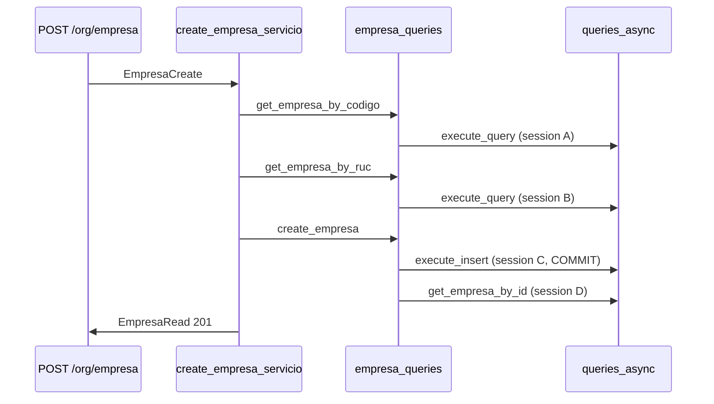
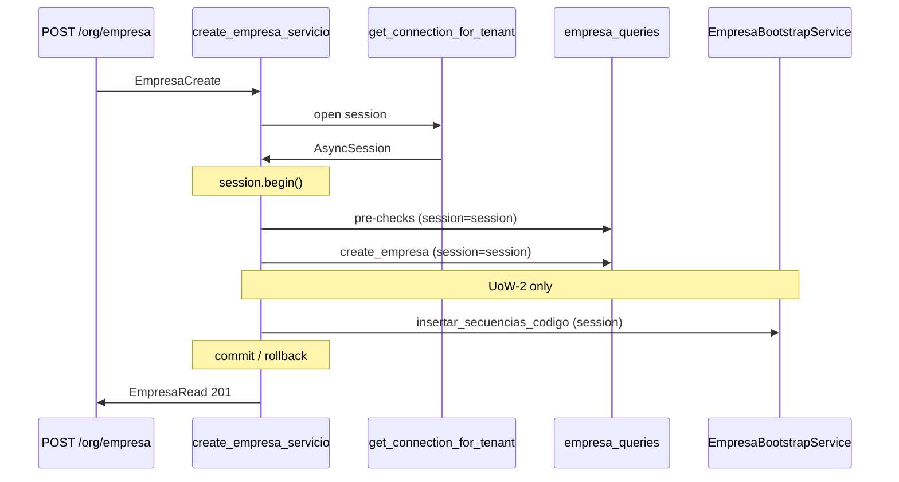

# ORG Unit of Work — Diseño arquitectónico (pre–Empresa Bootstrap V1)

**Proyecto:** Empresa Bootstrap V1 — Etapa previa (ORG UoW)  
**Fecha:** 2026-07-10  
**Estado:** Solo diseño — sin implementación  
**Prerequisito:** [`01_ORG_INTEGRATION_AUDIT.md`](01_ORG_INTEGRATION_AUDIT.md)  
**Alcance:** Preparar ORG para TX atómica `INSERT org_empresa` + bootstrap cfg (futuro). **No** implementa Empresa Bootstrap V1.

---

## 1. Resumen ejecutivo

El módulo ORG opera hoy en modo **auto-commit por operación**: cada `execute_insert` / `execute_update` abre su propia `AsyncSession`, ejecuta y hace `commit` antes de retornar. No existe Unit of Work en la capa de servicios.

Empresa Bootstrap V1 requiere que `create_empresa_servicio` y `EmpresaBootstrapService.insertar_secuencias_codigo()` compartan **una** sesión y **una** transacción. Esta etapa diseña la migración **Strangler** mínima para habilitarlo **sin** cambiar contratos API, OpenAPI ni comportamiento observable de ningún endpoint existente.

**Decisión normativa:** adoptar el patrón **session optional dual-path** ya usado en `auth_config_queries_core.py` y `CfgCodigoSecuenciaRepository`, con apertura UoW vía `get_connection_for_tenant(..., tenant_data)` — **no** `get_db_connection(ADMIN)` (Dedicated exige tenant store; ADJ-03 cfg).

---

## 2. Auditoría AS-IS — sesiones ORG

### 2.1 Dónde se crea la AsyncSession hoy

| Origen | Mecanismo | Scope ORG |
|--------|-----------|-----------|
| `queries_async._get_connection_context` | Context manager por llamada | **Único punto efectivo** |
| `DEFAULT` + `client_id` | `get_connection_for_tenant(cliente_id, tenant_data)` | Todas las queries ORG |
| `ADMIN` | `get_db_connection(ADMIN)` | **No usado** por ORG |

**Flujo por capa:**

```
Endpoint ORG
  → *_servicio (sin session)
    → *_queries (sin session)
      → execute_query | execute_insert | execute_update
        → _get_connection_context(DEFAULT, client_id)
          → get_connection_for_tenant  →  AsyncSession (nueva, por llamada)
```

Los servicios ORG (`empresa_service`, `sucursal_service`, etc.) **nunca** reciben ni propagan `AsyncSession`. La sesión vive exclusivamente dentro de `queries_async.py`.

### 2.2 Componentes ORG que usan `execute_insert`

| Archivo queries | Función | Entidad |
|-----------------|---------|---------|
| `empresa_queries.py` | `create_empresa` | `org_empresa` |
| `sucursal_queries.py` | `create_sucursal` | `org_sucursal` |
| `departamento_queries.py` | `create_departamento` | `org_departamento` |
| `cargo_queries.py` | `create_cargo` | `org_cargo` |
| `centro_costo_queries.py` | `create_centro_costo` | `org_centro_costo` |
| `parametro_queries.py` | `create_parametro` | `org_parametro_sistema` |

**Total INSERT writers ORG:** 6 funciones (1 por entidad maestra).

### 2.3 Componentes con commit implícito

| Helper | SELECT | INSERT/UPDATE/DELETE |
|--------|--------|----------------------|
| `execute_query` (Core Select) | Sin commit | N/A |
| `execute_query` (Core Update/Delete/Insert) | — | **`await session.commit()`** |
| `execute_insert` | — | **`await session.commit()`** |
| `execute_update` | — | **`await session.commit()`** |

**Implicación en `create_empresa` (AS-IS):**

```
get_empresa_by_codigo   → execute_query (sesión A, read, sin commit)
get_empresa_by_ruc      → execute_query (sesión B, read, sin commit)
create_empresa          → execute_insert (sesión C, INSERT + commit)
get_empresa_by_id       → execute_query (sesión D, read post-commit)
```

Mínimo **4 sesiones** por creación; el INSERT ya está persistido antes de cualquier hook futuro.

### 2.4 Queries que deben aceptar AsyncSession externa (alcance UoW)

**Fase UoW-1 (solo path `POST /org/empresa`):**

| Query | Motivo | Prioridad |
|-------|--------|-----------|
| `create_empresa` | Escritura dentro de TX | **P0** |
| `get_empresa_by_id` | Lectura post-INSERT en misma TX (pre-commit) | **P0** |
| `get_empresa_by_codigo` | Pre-check unicidad en misma TX (opcional recomendado) | P1 |
| `get_empresa_by_ruc` | Pre-check unicidad en misma TX (opcional recomendado) | P1 |

**Fuera de Fase UoW-1 (sin cambio en esta etapa):**

- `update_empresa`, `list_empresas`, resto de entidades ORG
- `execute_insert` / `execute_update` globales en `queries_async.py`

### 2.5 Métodos que pueden seguir sin cambios

| Capa | Componentes | Condición |
|------|-------------|-----------|
| Presentation | Todos los endpoints ORG | Sin cambio de firma ni response |
| Services read | `list_*`, `get_*`, `delete_*`, `reactivar_*`, `update_*` | Siguen auto-commit |
| Queries read-only | `list_*`, lookups sin TX compartida | Dual-path no requerido |
| Queries write otras entidades | sucursal, cargo, departamento, centro_costo, parametro | Strangler fase posterior |
| `queries_async.py` | Helpers globales | **No modificar** en UoW-1 |
| Bootstrap V2 | TBO, EBS, `seed_cfg_*` | Ya session-driven; sin cambio |

### 2.6 Impacto sobre otros endpoints ORG

| Endpoint | Impacto UoW-1 | Notas |
|----------|---------------|-------|
| `POST /org/empresa` | **Refactor interno** | Misma respuesta `EmpresaRead` 201 |
| `GET/PUT/DELETE/POST reactivar` empresa | **Ninguno** | Auto-commit preservado |
| Sucursales, cargos, departamentos, centros costo, parámetros | **Ninguno** | 20+ endpoints write sin cambio |
| Consumidores internos `get_empresa_servicio` | **Ninguno** | Read path intacto |

**Contrato observable:** idéntico status codes, payloads, validaciones, mensajes ConflictError.

### 2.7 Patrón UoW a reutilizar desde Bootstrap V2

| Referencia | Patrón | Aplicabilidad ORG |
|------------|--------|-------------------|
| `ClienteOnboardingService.crear_cliente_con_onboarding` | `async with get_db_connection(ADMIN) as session:` + `async with session.begin():` | **Parcial** — conexión distinta |
| `TenantBootstrapOrchestrator.orchestrate_shared_onboarding` | Orquestador recibe `session`; subpasos sin commit propio | **Sí** — modelo de orquestación |
| `EmpresaBootstrapService.insertar_secuencias_codigo` | `(session, cliente_id, empresa_id)` obligatorio | **Sí** — callee futuro |
| `cfg_codigo_onboarding_seed.seed_cfg_empresa` | Escritura vía repo con `session=` | **Sí** — callee futuro |
| `CfgCodigoSecuenciaRepository` | Escritura **prohibida** sin session (ADJ-03) | **Crítico** — ORG debe usar tenant store |
| `auth_config_queries_core` | `session: Optional[AsyncSession] = None` dual-path | **Sí** — plantilla queries ORG |

**Diferencia clave vs onboarding Shared:**

| Aspecto | Onboarding Shared | ORG runtime |
|---------|-------------------|-------------|
| Apertura sesión | `get_db_connection(ADMIN)` | `get_connection_for_tenant(client_id, tenant_data)` |
| Motivo | CP + tenant en misma BD Shared | Dedicated: tenant store ≠ Control Plane |
| Commit | `session.begin()` en caller | `session.begin()` en caller (nuevo) |

**Plantilla normativa ORG UoW (target):**

```python
from app.core.tenant.routing import (
    get_connection_for_tenant,
    OPERATION_CLASS_TENANT_DATA,
)

async with get_connection_for_tenant(
    client_id, OPERATION_CLASS_TENANT_DATA
) as session:
    async with session.begin():
        # pre-checks, create_empresa(..., session=session)
        # [futuro V1] EmpresaBootstrapService.insertar_secuencias_codigo(...)
    # commit al salir de begin(); rollback automático en excepción
```

### 2.8 Cambios mínimos para compatibilidad completa

1. **Dual-path en queries empresa** — `session=None` → ruta actual `execute_*` (comportamiento idéntico).
2. **Dual-path en servicio** — `create_empresa_servicio` abre UoW internamente; firma pública sin `session`.
3. **No tocar** endpoints, schemas, permisos RBAC.
4. **No tocar** otras entidades ORG en UoW-1.
5. **No invocar** EBS en UoW-1 (preparación solamente; smoke test TX vacía).

### 2.9 Pruebas de rollback requeridas (post-implementación UoW)

| ID | Escenario | Expectativa |
|----|-----------|-------------|
| T-UoW-01 | `create_empresa` OK dentro de `session.begin()` | 1 fila `org_empresa`; commit visible en GET posterior |
| T-UoW-02 | Excepción **después** de INSERT, **antes** de commit (simulada) | 0 filas nuevas; GET by id → 404 |
| T-UoW-03 | ConflictError pre-check (`codigo_empresa` duplicado) | Sin INSERT; sin filas parciales |
| T-UoW-04 | ConflictError pre-check (`ruc` duplicado) | Idem T-UoW-03 |
| T-UoW-05 | Regresión suite ORG existente | 8 tests unit ORG verdes sin cambio de aserciones |
| T-UoW-06 | Dual-path legacy `session=None` en queries | Callers indirectos / tests mock sin session → mismo comportamiento |
| T-UoW-07 | **[Gate Empresa Bootstrap V1]** Seed cfg falla a mitad | Rollback conjunto: sin empresa ni cfg (fase posterior) |
| T-UoW-08 | **[Opcional integración]** Dedicated tenant routing | Misma sesión escribe en BD dedicada, no CP |

### 2.10 Riesgos al migrar ORG a session-driven

| ID | Riesgo | Sev. | Mitigación |
|----|--------|------|------------|
| R-UoW-01 | Usar `ADMIN` en lugar de `tenant_data` | **Crítica** | Norma explícita + code review; alinear con ADJ-03 |
| R-UoW-02 | Olvidar dual-path → romper callers sin session | Alta | Default `session=None`; tests T-UoW-06 |
| R-UoW-03 | `get_empresa_by_id` post-INSERT en sesión distinta → no ve uncommitted | Media | Misma session en create path |
| R-UoW-04 | Pre-checks fuera de TX → race TOCTOU | Media | Mover pre-checks dentro de `begin()` (P1); UNIQUE DB como red de seguridad |
| R-UoW-05 | Refactor accidental de `execute_*` global | Alta | **Fuera de alcance** UoW-1 |
| R-UoW-06 | Transaction nesting / `begin()` anidado | Media | Un solo `begin()` en servicio; queries sin commit |
| R-UoW-07 | Dedicated vs Shared routing distinto en tests | Media | Test integración con harness provisioning |
| R-UoW-08 | Scope creep a todas las entidades ORG | Baja | Strangler: solo empresa create en UoW-1 |

---

## 3. Inventario ORG — operaciones de escritura

| Recurso | POST create | PUT update | DELETE soft | Reactivar |
|---------|-------------|------------|-------------|-----------|
| empresa | ● | ● | ● | ● |
| sucursal | ● | ● | ● | ● |
| departamento | ● | ● | ● | ● |
| cargo | ● | ● | ● | ● |
| centro_costo | ● | ● | ● | ● |
| parametro | ● | ● | ● | ● |

**Candidato UoW inmediato:** solo `empresa` POST create.  
**Candidatos futuros (UoW-2+):** writes company-scoped que requieran efectos colaterales transaccionales.

---

## 4. Diseño Strangler — migración incremental

### 4.1 Principios

1. **Strangler Fig** — nueva ruta session-driven convive con auto-commit legacy.
2. **Compatibilidad hacia atrás** — `session=None` preserva AS-IS.
3. **Cero cambio observable** — mismos HTTP, mismos errores, mismos logs.
4. **Preparación, no feature** — UoW-1 no llama EBS; UoW-2 (Empresa Bootstrap V1) añade una línea.
5. **No tocar `queries_async.py`** — blast radius prohibido.

### 4.2 Fases

```
┌─────────────────────────────────────────────────────────────────┐
│ UoW-0 (este documento)     Diseño aprobado                      │
├─────────────────────────────────────────────────────────────────┤
│ UoW-1                      Queries empresa dual-path            │
│                            create_empresa_servicio + UoW        │
│                            Sin EBS                              │
├─────────────────────────────────────────────────────────────────┤
│ UoW-2 = Empresa Bootstrap V1                                      │
│                            + insertar_secuencias_codigo en TX   │
├─────────────────────────────────────────────────────────────────┤
│ UoW-3 (opcional futuro)    Otras entidades ORG / writes compuestos│
└─────────────────────────────────────────────────────────────────┘
```

### 4.3 UoW-1 — detalle de diseño (sin código)

#### 4.3.1 Capa queries (`empresa_queries.py`)

Extender firmas con `session: Optional[AsyncSession] = None`:

| Función | Path `session is not None` | Path `session is None` |
|---------|---------------------------|------------------------|
| `create_empresa` | `await session.execute(insert(...))` — **sin commit** | `execute_insert` (AS-IS) |
| `get_empresa_by_id` | `await session.execute(select(...))` | `execute_query` (AS-IS) |
| `get_empresa_by_codigo` | idem | idem |
| `get_empresa_by_ruc` | idem | idem |

**Referencia canónica:** `insert_config_core` / `select_config_id_by_cliente_id_core` en `auth_config_queries_core.py`.

#### 4.3.2 Capa servicio (`empresa_service.py`)

Refactor **interno** de `create_empresa_servicio`:

```
create_empresa_servicio(client_id, data)  # firma pública sin cambios
  log_org_tenant_scope(...)
  async with get_connection_for_tenant(client_id, tenant_data) as session:
    async with session.begin():
      if await get_empresa_by_codigo(..., session=session): ConflictError
      if await get_empresa_by_ruc(..., session=session): ConflictError
      row = await create_empresa(..., session=session)
      # UoW-2: await EmpresaBootstrapService.insertar_secuencias_codigo(session, ...)
  log + assert + return EmpresaRead
```

**Observables preservados:**

- Orden de validaciones (codigo → ruc → insert)
- Mensajes ConflictError literales
- `EmpresaRead` idéntico
- Logging post-commit (fuera de `begin()` aceptable; no afecta contrato)

#### 4.3.3 Qué NO cambia en UoW-1

- `update_empresa_servicio`, `delete_empresa_servicio`, `reactivar_empresa_servicio`
- Todos los endpoints y `org_deps.py`
- Resto de `queries/org/*`
- OpenAPI / `operationId`

### 4.4 UoW-2 — hook Empresa Bootstrap V1 (futuro, 1 línea)

Dentro del bloque `session.begin()` existente, después de `create_empresa`:

```
await EmpresaBootstrapService.insertar_secuencias_codigo(
    session, client_id, row["empresa_id"]
)
```

Sin cambio de firma pública ORG. Sin nuevo endpoint.

---

## 5. Diagrama AS-IS vs TARGET

### AS-IS



### TARGET (UoW-1 + preparado V1)



---

## 6. Matriz de compatibilidad

| Consumidor | Tipo | Cambio UoW-1 | Riesgo |
|------------|------|--------------|--------|
| `endpoints_empresa.crear_empresa` | HTTP | Ninguno | Nulo |
| `ensure_empresa_in_tenant` | Internal read | Ninguno | Nulo |
| Tests unit ORG (8 archivos) | Test | Ninguno esperado | Bajo |
| `empresa_queries.create_empresa` | Query | Dual-path | Medio — tests T-UoW-06 |
| Otros módulos ERP | Cross-import queries | Ninguno si session=None default | Bajo |
| Dedicated provisioning | No usa ORG create | Ninguno | Nulo |
| Motor códigos | No en create path UoW-1 | Ninguno hasta V1 | Nulo |

---

## 7. Criterios de aceptación UoW-1

- [ ] `create_empresa_servicio` usa una sola `AsyncSession` + `session.begin()` para create path
- [ ] Queries empresa soportan `session=None` (legacy) y `session=...` (UoW)
- [ ] Suite tests ORG existente verde sin modificar contratos
- [ ] Test T-UoW-02 demuestra rollback (INSERT revertido si excepción pre-commit)
- [ ] Ningún endpoint cambia OpenAPI
- [ ] Documentado que conexión es `tenant_data`, no ADMIN
- [ ] **No** se invoca EBS en UoW-1

---

## 8. Criterios de aceptación UoW-2 (Empresa Bootstrap V1 — referencia)

- [ ] T-UoW-07: fallo en seed → sin empresa persistida
- [ ] Empresa adicional tiene 56 cfg EMPRESA; cfg TENANT sigue en 1 fila
- [ ] F17D + gate regression verdes

---

## 9. Relación con documentación existente

| Documento | Acción post-UoW |
|-----------|-----------------|
| `empresa-bootstrap-v1/01_ORG_INTEGRATION_AUDIT.md` | R-EBV1-01 resuelto tras UoW-1 |
| `bootstrap-v2/design/04_BOOTSTRAP_EXTENSION_MODEL.md` | Modo ADDITIONAL habilitado tras UoW-2 |
| `bootstrap-v2/05_RISKS_AND_GAPS.md` G2/G3 | Cerrado tras UoW-2 |

---

## 10. Veredicto

**DISEÑO UoW APROBADO PARA IMPLEMENTACIÓN (UoW-1).**

La migración Strangler sobre `empresa_queries` + `create_empresa_servicio` es el cambio mínimo que:

1. No rompe ningún endpoint ORG.
2. Reutiliza el patrón session-driven de Bootstrap V2 / auth config.
3. Usa `get_connection_for_tenant(tenant_data)` compatible con Dedicated (ADJ-03).
4. Deja un único punto listo para Empresa Bootstrap V1 (una invocación EBS dentro del `begin()` existente).

**Orden de implementación recomendado:** UoW-1 → validar T-UoW-01..06 → UoW-2 (Empresa Bootstrap V1).
