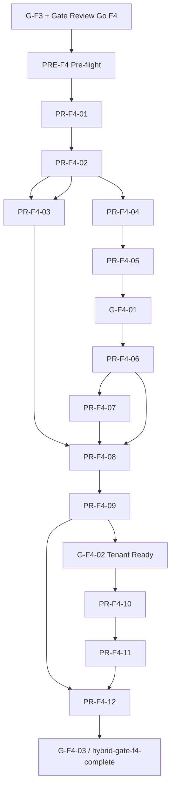

# IP-2.0 — Plan Oficial de Implementación  
## Fase F4 — Dedicated Database Provisioning

**Etapa:** 5.8 — Implementation Planning (F4)  
**Versión plan:** IP-2.0.1  
**Fecha:** 2026-06-25  
**Revisión:** Post Architecture Review IP-2.0 (cierre observaciones)  
**Baseline arquitectónico:** BL-F4-1.0 (APROBADO)  
**Baseline padre:** BL-1.0 (FROZEN)  
**Prerequisito de ejecución:** Gate Review G-F3 → Go F4  
**Alcance autorizado IP-2.0:** Fase **F4** únicamente  
**Estado:** **READY FOR IMPLEMENTATION** (post IP-2.0.1)  
**Restricción:** Planificación. Sin implementación en esta etapa.

---

## Changelog IP-2.0 → IP-2.0.1

| ID | Observación Architecture Review | Resolución documental |
|----|--------------------------------|----------------------|
| AR-C-01 | Dependencia S6→S7 vs paralelismo F4-06/F4-07 | Merge estricto F4-06 → F4-07; desarrollo paralelo solo en rama hasta merge F4-06 |
| AR-C-02 | DoD latencia HTTP en PR-F4-03 | Reubicado a PR-F4-08 |
| AR-C-03 | Alcance F4-08 mock vs F4-09 Ready | Sección §3.1 y DoD diferenciados: Saga implementada / Activación real / Tenant Ready |
| AR-C-04 | Suite Shared Onboarding no identificada | §10.1 `SHARED_ONBOARDING_REQUIRED_CHECK` permanente F4 |
| AR-C-05 | `dedicated_enabled` sin PR/DoD | Asignado a PR-F4-08 + DoD + PRE-F4 |
| AR-C-06 | 11 vs 12 WPs; tags inconsistentes | Corregido a 12 WPs; tags unificados §11 |

---

## 1. Objetivos de IP-2.0

| ID | Objetivo |
|----|----------|
| IP2-O01 | Convertir **BL-F4-1.0** en plan de ejecución **secuencial, verificable y sin improvisación** para Etapa 7 (F4). |
| IP2-O02 | Definir **12 Work Packages** y **12 Pull Requests** atómicos con whitelist, DoD y riesgos explícitos. |
| IP2-O03 | Garantizar **zero regresión Shared** (G-02) en cada merge F4. |
| IP2-O04 | Preservar **contratos OpenAPI existentes** (G-07); solo endpoints aditivos para status/retry/abort. |
| IP2-O05 | Cerrar formalmente **Q-030** (saga spec) y **Q-061** (DDL executor) vía implementación trazable. |
| IP2-O06 | Entregar **primer tenant dedicated Ready en staging** como evidencia Gate G-F4-03. |
| IP2-O07 | Establecer criterios objetivos de salida F4 y **entrada F5b** (Session route hardening). |
| IP2-O08 | Mantener **zero diff ERP operativo** (`modules/org`, `inv`, …) salvo excepción ADR. |

**Fuente única de verdad arquitectónica F4:** BL-F4-1.0  
**Fuente guardrails transversales:** BL-1.0 + `05_IMPLEMENTATION_GUARDRAILS.md`

---

## 2. Principios arquitectónicos que deberán respetarse

| # | Principio | Referencia | Verificación PR |
|---|-----------|------------|-----------------|
| PA-01 | **Control Plane ≠ Data Plane** — registry/estado en CP; DDL/seed en DP | ADR-001, BL-F4 §5 | Review arquitecto |
| PA-02 | **Saga async orquestada** — no single-TX cross-store | ADR-004-A+C, RD-12 | Test saga + state machine |
| PA-03 | **Metadata antes de tenant_data** — S8 post S7 | Q-031, RI-50 | Integration test orden |
| PA-04 | **Gateway reuse** — F4 no reimplementa routing | F0–F3 infra | Zero cambio firmas `execute_*` |
| PA-05 | **Invalidación cache obligatoria** pre-Ready | TD-02, BL-F4 §10 | Test cache + smoke S9 |
| PA-06 | **Single codebase** — sin `*_dedicated.py`, sin fork ERP | G-04 | grep CI |
| PA-07 | **OpenAPI stability** — `POST /clientes/` invariant | G-07, ADR-F4-03 | OpenAPI diff CI |
| PA-08 | **Infra encapsulation** — `database_type` solo whitelist F3 | G-10 | `check_database_type_whitelist.py` |
| PA-09 | **Idempotencia por paso** — markers + state guards | BL-F4 §15, TD-12 | Retry test 2× |
| PA-10 | **Compensación semi-automática** — no 2PC | TD-12, ADR-F4-04 | Abort test S3 |
| PA-11 | **Un PR = una intención** — target ≤500 LOC prod (excl. tests/SQL markers) | IP-1.0 EP-01 | Review diff stat |
| PA-12 | **Tests con o antes** de cambio infra/platform crítico | IP-1.0 EP-02 | CI |
| PA-13 | **Shared regression** obligatoria todo PR F4+ | G-02 | CI `shared-regression` |
| PA-14 | **Credenciales segregadas** — DDL platform ≠ app tenant | ADR-F4-01, Q-061 | Security review |
| PA-15 | **Catálogos dedicated = réplica read-only** en DP | ADR-011-A | F3.5 checklist |
| PA-16 | **Orden saga S6→S7** — catálogo antes seed tenant | BL-F4 §5, RI-50 | Merge F4-06 antes F4-07 |

---

## 3. Fases de implementación

### 3.1 Modelo de madurez: Saga vs Ready vs Activación

| Concepto | Definición | PR / Gate donde se cumple |
|----------|------------|---------------------------|
| **Saga implementada** | Orquestador ejecuta S1–S10 con delegación real en S1–S7; S8–S10 invocan servicios de activación (pueden ser stubs hasta F4-09) | **PR-F4-08** merge |
| **Activación real** | S8 metadata CP + S9 invalidación cache + smoke gateway + S10 transición técnica | **PR-F4-09** merge |
| **Tenant Ready** | `provisioning_state=ready`; tráfico ERP permitido vía Hybrid Gateway; smoke staging OK | **Gate G-F4-02** (post PR-F4-09) |

**Regla normativa:** Ningún PR, test ni gate puede declarar **Tenant Ready** antes de **PR-F4-09** merged y **G-F4-02** firmado. **PR-F4-08** puede mergear con saga completa en código pero **sin** criterio Ready.

### 3.2 Sub-fases

```
┌─────────────────────────────────────────────────────────────────────────┐
│ PRE-F4 — Entrada Etapa 7                          │ ~3–5 días │ Gate 0 │
├─────────────────────────────────────────────────────────────────────────┤
│ F4.1 — Provisioning State (CP)                    │ ~1 sem    │ 2 PRs  │
├─────────────────────────────────────────────────────────────────────────┤
│ F4.2 — Dedicated Infrastructure (Executor+DDL)  │ ~1.5 sem  │ 3 PRs  │
│         ═══ G-F4-01 ═══                                               │
├─────────────────────────────────────────────────────────────────────────┤
│ F4.3 — Seed & Catalog (DP)                        │ ~1.5 sem  │ 2 PRs  │
│         (merge secuencial F4-06 → F4-07)                              │
├─────────────────────────────────────────────────────────────────────────┤
│ F4.4 — Saga Orchestration & Activation            │ ~1.5 sem  │ 3 PRs  │
│         ═══ G-F4-02 (Tenant Ready) ═══                                  │
├─────────────────────────────────────────────────────────────────────────┤
│ F4.5 — API Status, E2E & Observability            │ ~1 sem    │ 2 PRs  │
│         ═══ G-F4-03 / Gate F5b ═══                                    │
├─────────────────────────────────────────────────────────────────────────┤
│ CHECKPOINT: tag hybrid-gate-f4-complete                               │
│ GATE REVIEW → autorización F5b (fuera scope IP-2.0)                   │
└─────────────────────────────────────────────────────────────────────────┘
```

| Sub-fase | Foco | PRs | Duración est. |
|----------|------|-----|---------------|
| **PRE-F4** | Pre-flight, ADR-F4, F3.5 catalog ack | — | 3–5 días |
| **F4.1** | Modelo estado CP, servicios lectura/escritura estado | F4-01, F4-02 | 1 sem |
| **F4.2** | Executor BD física + bootstrap_v2 runner + dispatcher | F4-03, F4-04, F4-05 | 1.5 sem |
| **F4.3** | Catálogos ADR-011 + seed tenant DP | F4-06, F4-07 | 1.5 sem |
| **F4.4** | Orquestador saga, metadata, cache, activación | F4-08, F4-09, F4-10 | 1.5 sem |
| **F4.5** | API status/retry/abort, E2E staging, métricas | F4-11, F4-12 | 1 sem |
| **Total F4** | | **12 PRs** | **6–8 semanas** (2–3 devs) |

---

## 4. Work Packages (WP)

### Leyenda

Cada WP incluye: objetivo, alcance, archivos permitidos/prohibidos, dependencias, riesgos, validaciones, criterios salida, PR asociado, trazabilidad BL-F4.

---

### PRE-F4-WP00 — Pre-flight Etapa 7

| Campo | Contenido |
|-------|-----------|
| **Objetivo** | Autorizar inicio F4 tras G-F3 y Gate Review |
| **Alcance** | Checklists; ack BL-F4-1.0; ADR-F4-01…05 ratificados; F3.5 catalog list firmada; `SHARED_ONBOARDING_REQUIRED_CHECK` registrado en CI |
| **Permitido** | Documentación ADR; minutes Gate Review; actualización IP-2.0 |
| **Prohibido** | Código producción |
| **Dependencias** | G-F3, tag `hybrid-bl10-f0-f3-complete`, Go/No-Go F4 |
| **Riesgos** | Iniciar F4 sin F3 mergeado → **bloqueante** |
| **Validaciones** | `08_PHASE_CHECKLISTS` IP-1.0 §5 100%; Q-030 cerrado por BL-F4-1.0 |
| **Salida** | Pre-flight F4 checklist firmado |
| **PR** | — (proceso) |
| **Trace** | BL-PEND-01, Q-030, Q-061, ADR-011 |

---

### F4-WP01 — CP provisioning state model

| Campo | Contenido |
|-------|-----------|
| **Objetivo** | Persistir `provisioning_state`, runs y step markers en CP |
| **Alcance** | DDL CP-only (tablas saga); schemas internos; sin orquestación |
| **Permitido** | `app/bootstrap_v2/01_schema/` (script CP nuevo autorizado Gate), `app/infrastructure/database/tables.py`, queries CP platform, `modules/tenant/application/provisioning/` (types) |
| **Prohibido** | ERP modules; `routing.py` changes; executor DDL |
| **Dependencias** | PRE-F4-WP00 |
| **Riesgos** | DDL CP requiere ADR excepción BL-R01 → autorizado F4 Gate Review |
| **Validaciones** | Migración aplicable staging CP; unit state enum |
| **Salida** | Tablas `tenant_provisioning_run`, `tenant_provisioning_step` operativas |
| **PR** | PR-F4-01 |
| **Trace** | BL-F4 §4, §8, ADR-004, Q-030 |

---

### F4-WP02 — Tenant provisioning state service

| Campo | Contenido |
|-------|-----------|
| **Objetivo** | CRUD estado, transiciones guardadas, historial steps |
| **Alcance** | `TenantProvisioningStateService`, `DedicatedProvisioningQueryService` |
| **Permitido** | `app/modules/tenant/application/services/` (nuevos `*_provisioning_*`), queries CP |
| **Prohibido** | Endpoints públicos; saga execution |
| **Dependencias** | F4-WP01 |
| **Riesgos** | Race conditions → row lock CP documentado |
| **Validaciones** | Unit tests transiciones; illegal transition rejected |
| **Salida** | API interna state service usable por orchestrator |
| **PR** | PR-F4-02 |
| **Trace** | BL-F4 §4, §15 |

---

### F4-WP03 — Provisioning job dispatcher

| Campo | Contenido |
|-------|-----------|
| **Objetivo** | Ejecución async in-process post-`POST /clientes/` (ADR-F4-05) |
| **Alcance** | Dispatcher; background task hook; correlación `run_id` |
| **Permitido** | `provisioning_job_dispatcher.py`, `app/core/config.py` (flags no-HTTP) |
| **Prohibido** | Cola externa; trigger HTTP en `cliente_service` (→ F4-WP08); `dedicated_enabled` (→ F4-WP08) |
| **Dependencias** | F4-WP02 |
| **Riesgos** | Worker crash mid-saga → persistencia step markers mitiga |
| **Validaciones** | Unit dispatch; job encolable sin bloquear caller |
| **Salida** | Job encolable con `cliente_id` + `run_id` |
| **PR** | PR-F4-03 |
| **Trace** | ADR-007-B, ADR-F4-05, BL-F4 §8 |

---

### F4-WP04 — Dedicated database executor

| Campo | Contenido |
|-------|-----------|
| **Objetivo** | CREATE DATABASE, login SQL, grants mínimos (Q-061) |
| **Alcance** | `DedicatedDatabaseExecutor` + config credencial platform DDL |
| **Permitido** | `app/infrastructure/provisioning/dedicated_database_executor.py`, `app/core/config.py`, `.env.example` |
| **Prohibido** | ERP; routing; onboarding services |
| **Dependencias** | F4-WP02 |
| **Riesgos** | **Alta** — permisos SQL Server staging |
| **Validaciones** | Integration test staging (opt-out CI local); idempotent CREATE |
| **Salida** | BD física creada con naming policy |
| **PR** | PR-F4-04 |
| **Trace** | Q-061, ADR-F4-01, BL-F4 §11 S3 |

---

### F4-WP05 — Bootstrap_v2 script runner

| Campo | Contenido |
|-------|-----------|
| **Objetivo** | Aplicar V010 + 05_dedicated/V010 con markers idempotentes |
| **Alcance** | `BootstrapScriptRunner`, tabla `bootstrap_applied` en DP |
| **Permitido** | `bootstrap_script_runner.py`, `script_manifest.py`, lectura `app/bootstrap_v2/` |
| **Prohibido** | Modificar contenido scripts bootstrap_v2 |
| **Dependencias** | F4-WP04 |
| **Riesgos** | Script order incorrecto → orden fijo BL-F4 §11 |
| **Validaciones** | Staging: tablas ERP existen post-run; re-run idempotente |
| **Salida** | S4–S5 saga steps implementables |
| **PR** | PR-F4-05 |
| **Trace** | BL-F4 §11, RI-50 |

---

### F4-WP06 — Dedicated catalog seed profile

| Campo | Contenido |
|-------|-----------|
| **Objetivo** | **S6** — catálogos S010–S066 según plan tenant (ADR-011) |
| **Alcance** | `DedicatedCatalogSeedService`; perfil por módulos plan |
| **Permitido** | `dedicated_catalog_seed_service.py`, `catalog_profiles.py` |
| **Prohibido** | Seed tenant data S7 (→ F4-WP07); catálogos en CP |
| **Dependencias** | F4-WP05, F3.5 catalog list |
| **Riesgos** | Drift catálogo CP↔DP → checksum/version marker |
| **Validaciones** | Conteo filas cat_* vs expected subset |
| **Salida** | Catálogos operativos en BD dedicada — **prerequisito merge F4-WP07** |
| **PR** | PR-F4-06 |
| **Trace** | ADR-011, BL-F4 §12 S6, PA-16 |

---

### F4-WP07 — Dedicated tenant seed (DP)

| Campo | Contenido |
|-------|-----------|
| **Objetivo** | **S7** — admin, roles, org_empresa, RBAC, secuencias **en DP** |
| **Alcance** | Adaptadores DP de onboarding existente; **no** seed CP para dedicated |
| **Permitido** | `cliente_onboarding_service.py` (delegación), `minimal_erp_tenant_bootstrap_service.py`, `onboarding_rbac_service.py`, `dedicated_tenant_seed_service.py` |
| **Prohibido** | Cambiar response `POST /clientes/`; ERP modules |
| **Dependencias** | **F4-WP06 merged** (S6 antes S7); F4-WP05 |
| **Riesgos** | **Crítica** — regresión shared onboarding |
| **Validaciones** | **`SHARED_ONBOARDING_REQUIRED_CHECK` 100%**; dedicated seed integration con catálogo presente |
| **Salida** | Tenant data en DP; CP solo registry |
| **PR** | PR-F4-07 |
| **Trace** | ADR-F4-02, RD-12, BL-F4 §12 S7, PA-16 |

**Nota desarrollo paralelo:** equipos pueden trabajar F4-WP06 y F4-WP07 en ramas separadas tras G-F4-01, pero **PR-F4-07 no puede mergear a `main` hasta PR-F4-06 merged**.

---

### F4-WP08 — Saga orchestrator core

| Campo | Contenido |
|-------|-----------|
| **Objetivo** | Coordinador S1–S10; reintentos; mutex por `cliente_id`; trigger async; **`dedicated_enabled`** |
| **Alcance** | `DedicatedProvisioningOrchestrator`, `StorageAllocationService`, trigger mínimo `cliente_service.py`, wiring S8–S10 vía interfaces (implementación real en WP09) |
| **Permitido** | `dedicated_provisioning_orchestrator.py`, `storage_allocation_service.py`, `cliente_service.py`, `app/core/config.py` (`DEDICATED_ENABLED`), `.env.example` |
| **Prohibido** | Activación real S8–S10 (→ F4-WP09); compensation (→ F4-WP10); endpoints status |
| **Dependencias** | F4-WP03, F4-WP06, F4-WP07 |
| **Riesgos** | **Alta** — orden steps; scope `cliente_onboarding` trigger |
| **Validaciones** | Unit per-step S1–S7; saga wiring S8–S10 delega a activation interface; **`SHARED_ONBOARDING_REQUIRED_CHECK`**; **`POST /clientes/` no bloquea >500ms** |
| **Salida** | **Saga implementada** (§3.1) — **no Tenant Ready** |
| **PR** | PR-F4-08 |
| **Trace** | ADR-004, BL-F4 §5, §8, BL-1.0 rollback flag |

---

### F4-WP09 — Storage metadata + cache activation

| Campo | Contenido |
|-------|-----------|
| **Objetivo** | **Activación real** S8–S10 — metadata, invalidación cache, smoke, Ready |
| **Alcance** | `DedicatedStorageMetadataService`, `DedicatedActivationService`; wire `invalidate_client_connection_cache` |
| **Permitido** | `conexion_service.py`, `dedicated_storage_metadata_service.py`, `dedicated_activation_service.py`, `routing.py` (hook invalidación **solo**) |
| **Prohibido** | Cambiar resolución routing core; refactor orchestrator |
| **Dependencias** | F4-WP08 |
| **Riesgos** | Cache stale → doble invalidación BL-F4 §10 |
| **Validaciones** | F0 harness; smoke S9; transición `provisioning→ready` |
| **Salida** | **Tenant Ready** alcanzable — evidencia **G-F4-02** |
| **PR** | PR-F4-09 |
| **Trace** | Q-031, BL-F4 §10, §13, §3.1 |

---

### F4-WP10 — Compensation service

| Campo | Contenido |
|-------|-----------|
| **Objetivo** | Compensación semi-automática por step; retry/abort internals |
| **Alcance** | `DedicatedProvisioningCompensationService`; DROP DB S3; cleanup metadata S8 |
| **Permitido** | `dedicated_provisioning_compensation_service.py`, executor DROP path |
| **Prohibido** | Auto-compensación cross-tenant; public API |
| **Dependencias** | F4-WP08, F4-WP09 |
| **Riesgos** | DROP accidental → guard `provisioning_state=failed` only |
| **Validaciones** | Abort test staging; orphan DB checklist |
| **Salida** | Retry desde last incomplete step idempotente |
| **PR** | PR-F4-10 |
| **Trace** | TD-12, BL-F4 §9, ADR-F4-04 |

**Ventana ops G-F4-02 → PR-F4-10:** entre G-F4-02 y merge F4-10, tenants `failed` en staging se gestionan con **runbook manual interim** (DROP DB / cleanup metadata) documentado en PRE-F4. No bloquea G-F4-02 (happy path Ready).

---

### F4-WP11 — Provisioning status API

| Campo | Contenido |
|-------|-----------|
| **Objetivo** | Endpoints aditivos status/retry/abort superadmin |
| **Alcance** | `GET .../provisioning-status`, `POST .../retry`, `POST .../abort` |
| **Permitido** | `endpoints_clientes.py`, `schemas*.py` (aditivos) |
| **Prohibido** | Breaking `POST /clientes/`; cambiar `POST /conexiones/` |
| **Dependencias** | F4-WP02, F4-WP10 |
| **Riesgos** | Information disclosure → DTO sanitizado |
| **Validaciones** | OpenAPI aditivo; RBAC superadmin |
| **Salida** | API operable para ops |
| **PR** | PR-F4-11 |
| **Trace** | G-07, ADR-F4-03 |

---

### F4-WP12 — E2E harness, observability & runbook

| Campo | Contenido |
|-------|-----------|
| **Objetivo** | Evidencia G-F4-03; métricas; runbook staging |
| **Alcance** | Integration E2E saga; extend F0 harness; docs runbook |
| **Permitido** | `tests/integration/test_hybrid_provisioning_*`, `helpers/`, `docs/implementation/`, `.github/workflows/ci.yml` (job opt-in) |
| **Prohibido** | Secrets; ERP module tests changes |
| **Dependencias** | F4-WP09, F4-WP11 |
| **Riesgos** | CI flaky → mock + manual gate |
| **Validaciones** | E2E mock green; staging sign-off |
| **Salida** | DOD-F4 completo; tag `hybrid-gate-f4-complete` |
| **PR** | PR-F4-12 |
| **Trace** | BL-F4 §16, §19 |

---

### Resumen WP

| Sub-fase | WPs | PRs |
|----------|-----|-----|
| PRE-F4 | 1 (proceso) | 0 |
| F4.1 | 2 | 2 |
| F4.2 | 3 | 3 |
| F4.3 | 2 | 2 |
| F4.4 | 3 | 3 |
| F4.5 | 2 | 2 |
| **Total** | **12 + PRE** | **12** |

---

## 5. Pull Requests (PR) por cada WP

| Orden merge | PR ID | WP | Sub-fase | Título | Tamaño est. |
|-------------|-------|-----|----------|--------|-------------|
| 1 | PR-F4-01 | WP01 | F4.1 | platform: CP provisioning state tables + types | M (~350) |
| 2 | PR-F4-02 | WP02 | F4.1 | platform: tenant provisioning state service | M (~300) |
| 3 | PR-F4-03 | WP03 | F4.2 | platform: in-process provisioning job dispatcher | S (~150) |
| 4 | PR-F4-04 | WP04 | F4.2 | infra: dedicated database executor (Q-061) | M (~400) |
| 5 | PR-F4-05 | WP05 | F4.2 | infra: bootstrap_v2 script runner + markers | M (~350) |
| 6 | PR-F4-06 | WP06 | F4.3 | platform: dedicated catalog seed profile (ADR-011) | M (~300) |
| 7 | PR-F4-07 | WP07 | F4.3 | platform: dedicated tenant seed DP adapters | L (~450) |
| 8 | PR-F4-08 | WP08 | F4.4 | platform: saga orchestrator + dedicated_enabled | L (~450) |
| 9 | PR-F4-09 | WP09 | F4.4 | platform: activation cache smoke Ready transition | M (~280) |
| 10 | PR-F4-10 | WP10 | F4.4 | platform: provisioning compensation + retry logic | M (~320) |
| 11 | PR-F4-11 | WP11 | F4.5 | api: provisioning status retry abort endpoints | S (~200) |
| 12 | PR-F4-12 | WP12 | F4.5 | test: provisioning e2e observability runbook | M (~400 tests) |

**Est. LOC producción acumulado:** ~3,300 | **Est. LOC tests:** ~1,800

---

## 6. Dependencias entre PR

### Diagrama



### Matriz de dependencias directas

| PR | Debe mergearse después de | Gate previo |
|----|---------------------------|-------------|
| PR-F4-01 | PRE-F4, G-F3 Go | Gate Review |
| PR-F4-02 | PR-F4-01 | — |
| PR-F4-03 | PR-F4-02 | — |
| PR-F4-04 | PR-F4-02 | — |
| PR-F4-05 | PR-F4-04 | — |
| PR-F4-06 | PR-F4-05 | **G-F4-01** |
| PR-F4-07 | **PR-F4-06** (S6→S7) | **G-F4-01** |
| PR-F4-08 | PR-F4-03, PR-F4-06, PR-F4-07 | — |
| PR-F4-09 | PR-F4-08 | — |
| PR-F4-10 | PR-F4-08, PR-F4-09 | **G-F4-02** recomendado |
| PR-F4-11 | PR-F4-02, PR-F4-10 | — |
| PR-F4-12 | PR-F4-09, PR-F4-11 | — |

### Reglas de paralelismo

| Paralelismo | Tipo | Condición |
|-------------|------|-----------|
| PR-F4-03 ∥ PR-F4-04 | **Desarrollo + merge** | Tras PR-F4-02 |
| PR-F4-06 ∥ PR-F4-07 | **Solo desarrollo en rama** | Tras G-F4-01; **merge F4-07 solo post F4-06** |
| PR-F4-06 → PR-F4-07 | **Merge secuencial obligatorio** | S6 catálogo antes S7 seed (PA-16) |
| Tenant Ready | **Gate** | Solo post PR-F4-09 (G-F4-02) |

---

## 7. Whitelist de archivos permitidos por PR

*(Sin cambios de alcance respecto IP-2.0; se mantiene whitelist original por PR.)*

### Whitelist transversal F4

| Zona | Fases F4 |
|------|----------|
| `app/infrastructure/provisioning/**` | F4.2–F4.4 |
| `app/modules/tenant/application/services/*provisioning*`, onboarding refactor acotado | F4.1–F4.4 |
| `app/modules/tenant/presentation/endpoints_clientes.py` | F4.5 |
| `app/core/tenant/routing.py`, `cache.py` | F4.4 F4-09 hooks mínimos |
| `app/core/config.py` | F4-03 (flags no-HTTP), **F4-08 (`DEDICATED_ENABLED`)** |
| `app/bootstrap_v2/` | F4.1 DDL CP; lectura F4.2 |
| `tests/integration/test_hybrid_*`, `helpers/` | F4.5 |
| `app/modules/{org,inv,pur,...}/**` | **PROHIBIDO** |

### PR-F4-08 — adición `dedicated_enabled`

| Permitido adicional | DoD |
|---------------------|-----|
| `app/core/config.py`: `DEDICATED_ENABLED` (default `false`) | Prod/staging policy documentada |
| `.env.example`: variable documentada | SRE verifica prod `false` |
| Orchestrator: no-op saga si `DEDICATED_ENABLED=false` | Shared path idéntico |

---

## 8. Restricciones (BL-F4)

*(Sin cambios — BLF4-R01…R18 se mantienen.)*

Adición **BLF4-R19:** PR-F4-07 **no merge** sin PR-F4-06 merged (S6→S7).

---

## 9. Riesgos técnicos por PR

*(Sin cambios materiales — riesgos originales vigentes.)*

Mitigación adicional documentada:

| Riesgo | Mitigación IP-2.0.1 |
|--------|---------------------|
| S7 sin S6 | BLF4-R19 + merge order |
| Ready prematuro | §3.1 + G-F4-02 solo post F4-09 |
| `dedicated_enabled` prod | DoD F4-08 + PRE-F4 PF4-09 |

---

## 10. Definition of Done por PR

### 10.1 SHARED_ONBOARDING_REQUIRED_CHECK (permanente F4)

**Required Check obligatorio en todo PR F4 desde PR-F4-07 en adelante**, y recomendado en PR-F4-01…06 como smoke parcial cuando se toque `modules/tenant/`.

Comando normativo:

```text
pytest tests/unit/test_onboarding_rbac_bootstrap.py \
       tests/unit/test_onboarding_menu_bootstrap.py \
       tests/unit/test_minimal_erp_tenant_bootstrap.py \
       tests/unit/test_platform_identity_bootstrap.py \
       tests/unit/test_tenant_exception_propagation.py \
       tests/unit/test_base_operative_t1.py \
       -q --tb=line
```

Además, en **todo merge F4**: CI job `shared-regression` (`scripts/validate_shared_regression.py`) — gate G-02.

| Suite | Rol |
|-------|-----|
| `SHARED_ONBOARDING_REQUIRED_CHECK` | Regresión onboarding shared — **obligatorio F4-07+** |
| `shared-regression` (F2) | Regresión shared global — **obligatorio todo PR F4** |

---

### DoD transversal PR F4

Extiende IP-1.0 DOD-PR-01…10 + DOD-F4-PR-01…10 originales.

| # | Criterio |
|---|----------|
| DOD-F4-PR-11 | `SHARED_ONBOARDING_REQUIRED_CHECK` green cuando WP toca onboarding/tenant services |
| DOD-F4-PR-12 | Tag naming conforme §11 |

---

### DoD específico por PR (actualizado)

| PR | Criterios adicionales |
|----|----------------------|
| **F4-01** | Tablas CP creadas staging; enums `provisioning\|ready\|failed` |
| **F4-02** | Unit: transición ilegal rechazada; historial steps persistido |
| **F4-03** | Unit: job encolado con `run_id`; **sin** criterio latencia HTTP |
| **F4-04** | CREATE DATABASE idempotente staging; login creado |
| **F4-05** | V010 + 05_dedicated aplicados; re-run sin error |
| **F4-06** | Catálogos según perfil plan; conteo mínimo verificado (**S6 complete**) |
| **F4-07** | **`SHARED_ONBOARDING_REQUIRED_CHECK` 100%**; dedicated seed en DP; tests asumen catálogo S6 presente |
| **F4-08** | Saga S1–S10 wired; S8–S10 delegan activation service; **`POST /clientes/` dedicated no bloquea >500ms**; **`DEDICATED_ENABLED=false` → shared idéntico**; **`SHARED_ONBOARDING_REQUIRED_CHECK` 100%**; **no declarar Ready** |
| **F4-09** | Invalidación cache invocada; smoke gateway pass; **`provisioning→ready` una sola vez**; **Tenant Ready verificable** |
| **F4-10** | Abort S3 → `failed`; retry idempotente 2× |
| **F4-11** | OpenAPI aditivo; RBAC superadmin |
| **F4-12** | E2E mock green; runbook staging; métricas BL-F4 §16 |

---

### DoD — Fase F4 completa

| # | Criterio | Evidencia |
|---|----------|-----------|
| DOD-F4-01 | PR-F4-01…12 merged | Git log |
| DOD-F4-02 | Tenant dedicated staging **Ready** E2E | Runbook sign-off |
| DOD-F4-03 | `shared-regression` green post-F4 | CI |
| DOD-F4-04 | `SHARED_ONBOARDING_REQUIRED_CHECK` green final | CI |
| DOD-F4-05 | Retry 2× sin duplicados | Test |
| DOD-F4-06 | Compensación S3 probada | Test abort |
| DOD-F4-07 | Cache invalidation <5s | Test |
| DOD-F4-08 | OpenAPI diff clean cumulative F4 | CI |
| DOD-F4-09 | Zero ERP module diffs | grep gate |
| DOD-F4-10 | Observabilidad 5 métricas BL-F4 §16 | Dashboard |
| DOD-F4-11 | Security review §17 sign-off | Checklist |
| DOD-F4-12 | **Gate G-F4-03** 100% | Signed |
| DOD-F4-13 | Tag **`hybrid-gate-f4-complete`** | Git |

---

## 11. Gates de aprobación

### Gate 0 — PRE-F4

| # | Item | Evidencia |
|---|------|-----------|
| PF4-01 | G-F3 checklist IP-1.0 §5 100% | Signed |
| PF4-02 | Tag `hybrid-bl10-f0-f3-complete` | Git |
| PF4-03 | Gate Review Go F4 — minutes | Doc |
| PF4-04 | BL-F4-1.0 ack | All |
| PF4-05 | ADR-F4-01…05 ratificados | Doc |
| PF4-06 | F3.5 catalog list ADR-011 | Doc |
| PF4-07 | Q-030 cerrado (= BL-F4-1.0) | Trace |
| PF4-08 | Staging SQL DDL creds | Vault |
| PF4-09 | **`dedicated_enabled=false` verificado prod** | SRE |
| PF4-10 | Branch `hybrid/f4-provisioning` | Git |
| PF4-11 | **`SHARED_ONBOARDING_REQUIRED_CHECK` registrado CI/docs** | PR template |

---

### Gate G-F4-01 — Entrada F4.3 (Seed)

| # | Item |
|---|------|
| GF4-01-01 | PR-F4-01…05 merged |
| GF4-01-02 | CREATE DATABASE staging OK |
| GF4-01-03 | bootstrap_v2 V010 + 05_dedicated OK |
| GF4-01-04 | Re-run bootstrap idempotente |
| GF4-01-05 | shared-regression green |
| GF4-01-06 | Tag **`hybrid-gate-f4-01`** |

---

### Gate G-F4-02 — Tenant Ready (post-activación)

| # | Item |
|---|------|
| GF4-02-01 | PR-F4-06…09 merged (**F4-06 antes F4-07 verificado**) |
| GF4-02-02 | Dedicated seed en DP verificado |
| GF4-02-03 | Metadata + cache + smoke OK |
| GF4-02-04 | **Tenant staging `ready` — activación real (§3.1)** |
| GF4-02-05 | `SHARED_ONBOARDING_REQUIRED_CHECK` + shared-regression green |
| GF4-02-06 | Runbook manual interim failed tenants (pre-F4-10) ack SRE |
| GF4-02-07 | Tag **`hybrid-gate-f4-02`** |

---

### Gate G-F4-03 — Gate Review F5b (Final F4)

| # | Item |
|---|------|
| GF4-03-01 | PR-F4-10…12 merged |
| GF4-03-02 | DOD-F4 completo |
| GF4-03-03 | E2E mock + staging sign-off |
| GF4-03-04 | Métricas provisioning staging |
| GF4-03-05 | Security review F4 |
| GF4-03-06 | OpenAPI cumulative F0–F4 clean |
| GF4-03-07 | Zero ERP diffs |
| GF4-03-08 | Runbook `HYBRID_F4_PROVISIONING_RUNBOOK.md` |
| GF4-03-09 | Tag **`hybrid-gate-f4-complete`** |
| GF4-03-10 | Gate Review F5b scheduled |
| GF4-03-11 | Go/No-Go F5b recorded |

### Tags Git unificados (IP-2.0.1)

| Tag | Cuándo |
|-----|--------|
| `hybrid-gate-f4-01` | Post PR-F4-05; G-F4-01 |
| `hybrid-gate-f4-02` | Post PR-F4-09; Tenant Ready |
| `hybrid-gate-f4-complete` | Post PR-F4-12; DOD-F4; **tag final F4** |

---

## 12. Roadmap completo de implementación

*(Timeline W0–W7 sin cambios materiales.)*

| Semana | Actividad | Gate |
|--------|-----------|------|
| W0 | PRE-F4 | Gate 0 |
| W1 | F4-01, F4-02 | — |
| W2 | F4-03, F4-04, F4-05 | G-F4-01 |
| W3 | F4-06 → F4-07 (merge secuencial) | — |
| W4 | F4-08, F4-09 | G-F4-02 |
| W5 | F4-10 | — |
| W6 | F4-11, F4-12 | G-F4-03 |
| W7 | Buffer; Gate F5b | `hybrid-gate-f4-complete` |

---

## 13. Orden exacto de ejecución de todos los PR

| Orden | ID | Acción | Gate previo |
|-------|-----|--------|-------------|
| 0 | PRE-F4 | Pre-flight Gate 0 | G-F3 + Go F4 |
| 1 | PR-F4-01 | Merge CP state tables | Gate 0 |
| 2 | PR-F4-02 | Merge state service | F4-01 |
| 3 | PR-F4-03 | Merge job dispatcher | F4-02 |
| 4 | PR-F4-04 | Merge database executor | F4-02 |
| 5 | PR-F4-05 | Merge bootstrap runner | F4-04 |
| 6 | — | **G-F4-01** + tag `hybrid-gate-f4-01` | F4-01…05 |
| 7 | PR-F4-06 | Merge catalog seed (**S6**) | G-F4-01 |
| 8 | PR-F4-07 | Merge tenant seed DP (**S7**) | **F4-06** |
| 9 | PR-F4-08 | Merge saga orchestrator + `dedicated_enabled` | F4-03,06,07 |
| 10 | PR-F4-09 | Merge activation → **Tenant Ready** | F4-08 |
| 11 | — | **G-F4-02** + tag `hybrid-gate-f4-02` | F4-06…09 |
| 12 | PR-F4-10 | Merge compensation | G-F4-02 |
| 13 | PR-F4-11 | Merge status API | F4-10 |
| 14 | PR-F4-12 | Merge E2E + observability | F4-09,11 |
| 15 | — | **G-F4-03** + tag `hybrid-gate-f4-complete` | F4 complete |
| 16 | — | Gate Review F5b | Steering |

**Paralelismo autorizado:**
- Orden 3 ∥ Orden 4 (tras orden 2).
- Orden 7 y 8: **desarrollo paralelo en rama permitido**; **merge orden 8 solo tras orden 7**.

**Secuencia estricta merge:** 1 → 2 → (3∥4) → 5 → 6 → 7 → 8 → 9 → 10 → 11 → 12 → 13 → 14 → 15.

---

## 14. Criterios para iniciar F5b

*(Sin cambios — F5-ENTRY-01…12 vigentes.)*

---

## Declaración formal

```
╔══════════════════════════════════════════════════════════════════╗
║  IMPLEMENTATION PLAN IP-2.0.1 COMPLETE                            ║
║  Status: READY FOR IMPLEMENTATION                                 ║
║  Baseline: BL-F4-1.0 (APPROVED) — sin modificación               ║
║  Work Packages: 12 (+ PRE-F4)                                     ║
║  Pull Requests: 12 (sin altas/bajas)                              ║
║  Architecture Review: observaciones cerradas                      ║
╚══════════════════════════════════════════════════════════════════╝
```

**Primer paso ejecutable:** PRE-F4 Gate 0 (PF4-01…11) → **PR-F4-01**.
