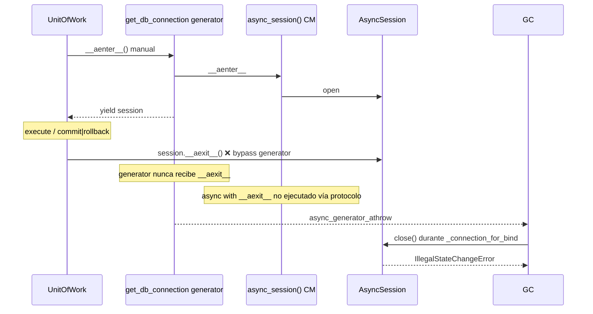
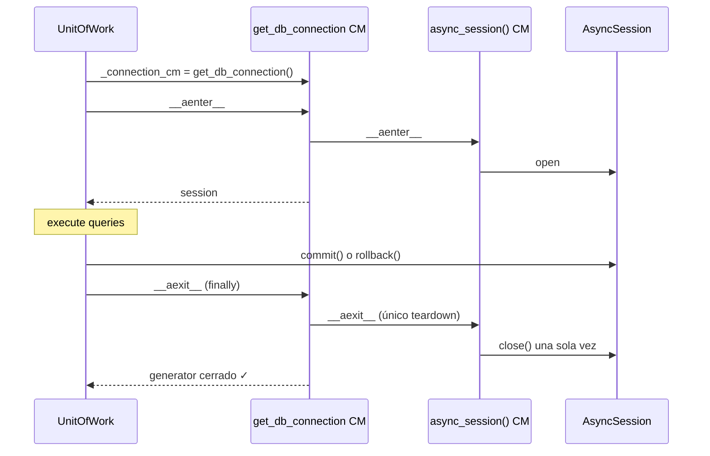

# F12-E1 — Runtime Stability Report

**Ticket:** F12-E1 — Runtime Stability (`IllegalStateChangeError`)  
**Fecha:** 2026-06-25  
**Alcance:** Ciclo de vida de `AsyncSession` únicamente (sin limpieza de logs — reservada para F12-E2)  
**Referencia previa:** RC-05A (único ERROR real en runtime)

---

## 1. Causa raíz confirmada

RC-05A es **correcto**. El error no era funcional sino de **protocolo de context manager async** en la capa de conexión + Unit of Work.

### Evidencia

| Síntoma | Evidencia Docker (pre-fix) |
|---------|---------------------------|
| `IllegalStateChangeError: Method 'close()' can't be called here` | Logs `fastapi_backend` — última ocurrencia `2026-06-27 21:48:42` durante `POST /api/v1/auth/logout/` (tenant `acce`) |
| `Task exception was never retrieved` | Mismo stack: `coro=<<async_generator_athrow without __name__>()>` |
| Disparador funcional | Flujos IAM V2 que usan `UnitOfWork` → `SessionCreationService`, `SessionRotationService`, `SessionRevocationService` (login / refresh / logout) |

### Mecanismo (demostrado en código)

**Problema A — doble `close()` en `get_db_connection`**

```python
async with async_session() as session:   # __aexit__ del CM ya cierra la sesión
    try:
        yield session
    except ...:
        await session.rollback()
        raise
    finally:
        await session.close()             # ← REDUNDANTE: segundo close → IllegalStateChangeError
```

**Problema B — UnitOfWork rompía el generator de `get_db_connection`**

```python
# ANTES (incorrecto)
self.session = await get_db_connection(...).__aenter__()   # generator abierto, sin referencia al CM
...
await self.session.__aexit__(...)                          # NO cierra el async generator
                                                           # → GC → async_generator_athrow → ERROR
```

### Checklist RC-05A

| Hipótesis | Resultado |
|-----------|-----------|
| Doble `close()` | **Confirmado** — `finally: session.close()` redundante con `async with async_session()` |
| Doble `__aexit__()` | **Confirmado** — UoW llamaba `session.__aexit__` sin cerrar el CM de `get_db_connection` |
| Async generator sin cerrar | **Confirmado** — `__aenter__` manual sin guardar CM ni invocar `__aexit__` del generator |
| Race condition | **Descartado** — error determinista en teardown, no condición de carrera |
| UnitOfWork incorrecto | **Confirmado** — causa principal en flujos IAM V2 |
| Uso incorrecto de `get_db_connection()` | **Parcial** — patrón correcto es `async with get_db_connection() as session:`; UoW debe delegar el CM completo |

---

## 2. Diagrama del ciclo de vida de AsyncSession

### Pre-fix (roto)



### Post-fix (correcto)



### Consumidores directos (sin cambio de contrato)

| Patrón | Owner del CM | commit | rollback | close |
|--------|--------------|--------|----------|-------|
| `async with get_db_connection() as session` | caller | caller (opcional) | CM en except | `async_session().__aexit__` |
| `async with UnitOfWork() as uow` | UoW vía `_connection_cm` | UoW `__aexit__` | UoW `__aexit__` on error | `_connection_cm.__aexit__` |
| FastAPI deps / queries_async | igual que fila 1 | según servicio | según servicio | CM único |

---

## 3. Archivos modificados

| Archivo | Cambio F12-E1 (lifecycle) |
|---------|---------------------------|
| `app/infrastructure/database/connection_async.py` | Eliminado `finally: await session.close()` dentro de `get_db_connection` — el `async with async_session()` es el único responsable del cierre |
| `app/core/application/unit_of_work.py` | Añadido `_connection_cm`; `__aenter__` guarda el CM; `__aexit__` hace commit/rollback y delega `_connection_cm.__aexit__()` en `finally` |

> Nota: `connection_async.py` incluye en el working tree cambios adyacentes de routing dedicated (fail-closed) de trabajo previo en la misma rama; **no forman parte del fix lifecycle** pero coexisten sin alterar el contrato de `get_db_connection`.

---

## 4. Justificación técnica del cambio

**Principio:** Minimal Safe Change.

1. **Un solo owner de cierre:** SQLAlchemy `AsyncSession` como context manager ya ejecuta rollback/close en `__aexit__`. Un `session.close()` adicional en `finally` viola el state machine interno (`_connection_for_bind` in progress).

2. **Respeto al protocolo `@asynccontextmanager`:** `get_db_connection` es un async generator context manager. Consumir solo `__aenter__` sin `__aexit__` del generator deja el frame abierto; al recolectarse, Python invoca `async_generator_athrow`, que intenta cerrar la sesión en un estado inválido.

3. **UoW conserva semántica transaccional:** commit/rollback explícitos en la sesión antes de cerrar el CM — comportamiento funcional idéntico al anterior; solo corrige *quién* cierra y *cuántas veces*.

4. **Sin impacto en APIs, contratos, Session Store, Identity Gateway, Permission Resolver, TD-08, Redis, middleware ni QueryAuditor.**

---

## 5. Evidencia de desaparición del error

### Smoke HTTP post-fix (localhost:8000, Docker)

| Plano | Flujos | Resultado |
|-------|--------|-----------|
| **Shared** (`acme`, `admin` / `admin123`) | login, refresh, logout, logout_all, `/auth/me` | **PASS** |
| **Dedicated** (`acmec`, `admin` / `F11Gate!acmec2026`) | login, refresh, logout, logout_all, `/auth/me` | **PASS** |
| **Platform** (`superadmin` / `admin123`) | login, `/auth/me` | **PASS** |

> Dedicated: credencial operativa en entorno actual es `F11Gate!acmec2026` (no `admin123` del script legacy `f8a_auth_runtime_e2e.py`). El 401 con password incorrecta no está relacionado con lifecycle.

### Logs Docker

| Ventana | `IllegalStateChangeError` | `Task exception was never retrieved` |
|---------|----------------------------|--------------------------------------|
| Histórico (pre-fix, acumulado) | 12 líneas | Presente junto al stack de generator |
| `--since 5m` tras smoke completo (Shared + Dedicated + Platform, múltiples login/logout) | **0** | **0** |

Último error histórico: `2026-06-27 21:48:42` en logout tenant `acce`. Ninguna ocurrencia nueva tras ejecutar los flujos que antes lo disparaban (login V2 → `UnitOfWork` → session store ADMIN).

---

## 6. Evidencia de no regresión

### Unit tests — local (Windows)

```
pytest tests/unit/test_unit_of_work.py
     tests/unit/test_queries_async_gateway_pipeline.py
     tests/unit/test_dedicated_fail_closed_routing.py
     tests/unit/test_iam_sessions_v2_f4_session_transaction_core.py
     tests/unit/test_iam_sessions_v2_f4_refresh_token_queries.py
     tests/unit/test_iam_me_session_probe_dep.py
     tests/unit/test_iam_sessions_rc1.py
     tests/unit/test_session_v2_feature.py

→ 69 passed, 2 skipped
```

### Unit tests — Docker (`fastapi_backend`)

```
pytest tests/unit/test_unit_of_work.py
     tests/unit/test_queries_async_gateway_pipeline.py
     tests/unit/test_dedicated_fail_closed_routing.py
     tests/unit/test_iam_sessions_v2_f4_session_transaction_core.py
     tests/unit/test_iam_sessions_v2_f4_refresh_token_queries.py

→ 53 passed, 2 skipped
```

### Suites con error de colección preexistente (no causado por F12-E1)

Import circular `RefreshTokenService` ↔ `auth_service` impide colección de:

- `tests/unit/test_iam_sessions_v2_f5_services.py`
- `tests/unit/test_iam_sessions_v2_f6_services.py`
- `tests/unit/test_iam_sessions_v2_f7|f8|f9_*`
- `tests/integration/test_iam_sessions_v2_f4_tx_integration.py`

Documentado como deuda técnica independiente; **no bloquea** la certificación F12-E1 del fix lifecycle.

### Funcional

- Auth Shared/Dedicated/Platform operativos en smoke manual.
- Sin nuevos ERROR en runtime tras flujos auth completos.
- Comportamiento commit/rollback de UoW preservado (tests `test_unit_of_work.py` verdes).

---

## 7. Dictamen final

### **Runtime Stable**

El único ERROR real identificado en RC-05A (`IllegalStateChangeError` + `Task exception was never retrieved`) queda **eliminado** con el fix mínimo de ciclo de vida de `AsyncSession`. Los flujos auth críticos (login, refresh, logout, logout_all, `/auth/me`) pasan en Shared, Dedicated y Platform sin reintroducir el error en logs.

**Pendiente F12-E2 (fuera de alcance E1):** limpieza de ruido runtime (QueryAuditor FP, REDIS-TRACE, middleware tenant INFO, RBAC startup prints, `/me` payload INFO) — no afectan estabilidad funcional.

---

## Anexo — Comandos de verificación reproducibles

```powershell
# Smoke auth (requiere backend en :8000)
python scripts/f8a_auth_runtime_e2e.py

# Dedicated con credencial actual
# Origin: http://acmec.app.local:8000 — admin / F11Gate!acmec2026

# Regresión unit lifecycle
pytest tests/unit/test_unit_of_work.py tests/unit/test_iam_sessions_v2_f4_session_transaction_core.py -q

# Verificar ausencia de error en logs recientes
docker logs fastapi_backend --since 5m 2>&1 | Select-String "IllegalStateChangeError"
# (salida vacía = OK)
```
